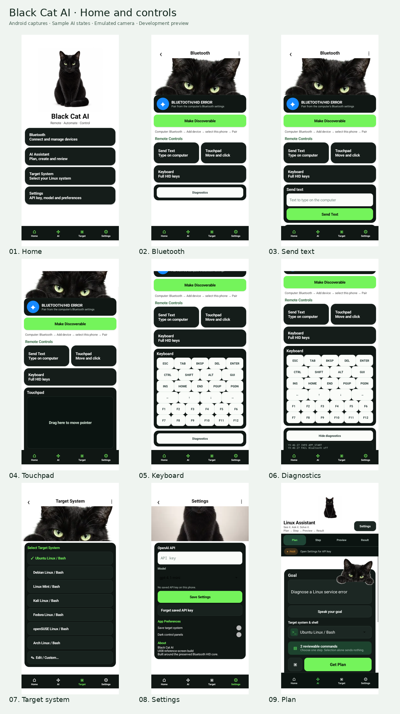
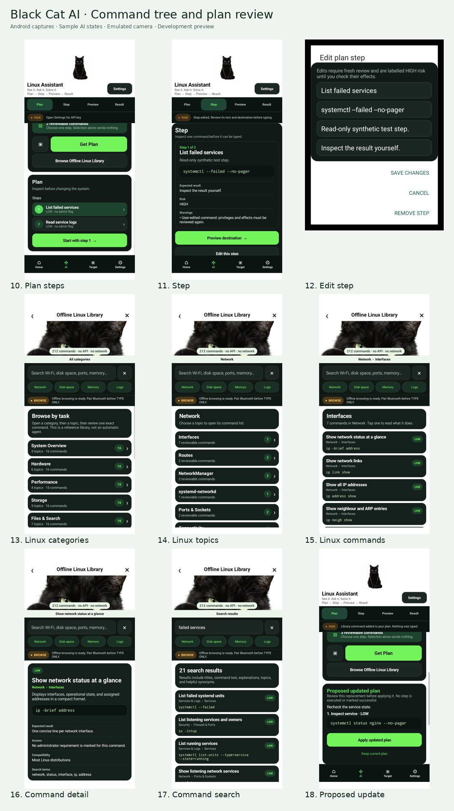
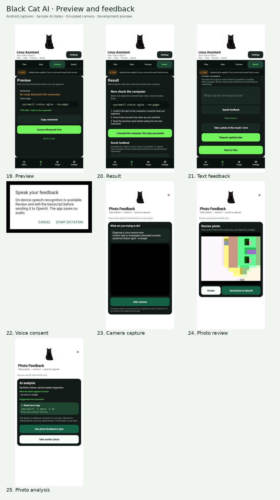

# Black Cat AI — UI10 screenshots

[Open all 25 screens as a PDF](Black-Cat-UI10-screenshots.pdf?raw=true) · [Download the full-size ZIP](Black-Cat-UI10-screenshots.zip?raw=true)

These are actual Android emulator app-window captures from source `84518cc33cd3ff1daa904a77c20e1da6128bc57c`. Plans, proposed updates, analysis and transmitted-state displays use synthetic test fixtures. The photo-review screen contains an image taken with the emulator’s virtual camera. No live AI request, speech transcription or Bluetooth typing was performed. Handset acceptance remains pending.

The three overviews below display all 25 captures. The PDF has one capture per page; the ZIP also includes the individual PNGs and a self-contained HTML gallery.

## Home and controls

## Command tree and plan review

## Preview and feedback

