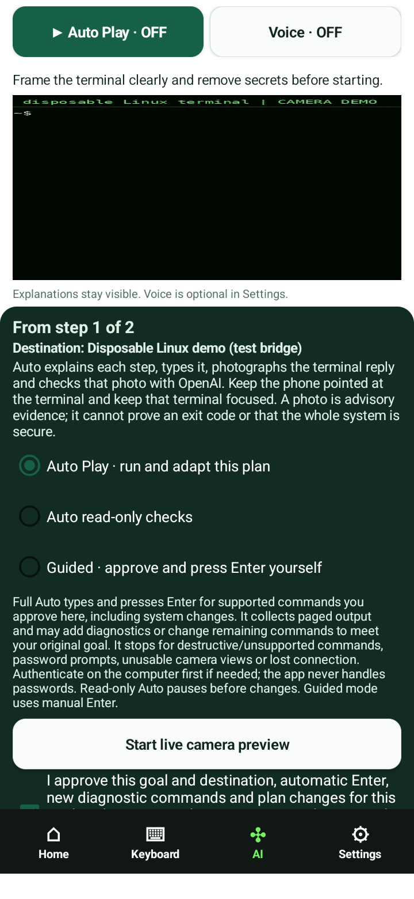

# Auto review — 15 October 2026

**Auto is not yet verified end to end on a real phone and Linux computer.**
The earlier UI13 native tests used real Camera2 JPEG captures but synthetic observations,
planner responses and a fake HID destination. They did not establish that OpenAI could
read those photographs. This review keeps that distinction explicit.

Reviewed branch: `feature/ui13-adaptive-auto`, commit
`fe98274ba4d300b7dabdc82021cbdc9536fe9a74`. The installed AI APK is the published UI13
artifact, SHA-256 `e87bc0c24f3514a45dbea88cfddd05fb8d4d5f1c83cd7eaed0880e1c2f0a4ea6`.
Its production source remains `7db3aed5607687236fb49bf493daf38a38ce357e`.
This branch adds review evidence and test fixtures; it does not change or replace that APK.

## Findings

### 1. Turning Auto off and on can leave the next session unable to proceed

**Confirmed by source and a new executed regression test.** After preparing the first
command, Auto publishes its generated capture/page/cleanup commands into the main plan.
Closing Auto clears the collection registry, while `AiPanel` retains the published plan.
A new session receives those helper commands without ownership of them. Its command
policy rejects the compound shell text and it waits for manual approval instead of
automatically progressing. This also affects reopening a finished plan containing helpers.
The protection against replay is correct; the task/session representation needs repair.

Evidence:

- `AutoAssistPanel.publish`, `advance` and `stopWork`.
- `AiEntry.openAutoAssist`: `workspace.replace(updated)` on publication, with no plan
  normalization on close.
- `AutoRunSession.canRun` and `prepareCurrent`.
- `AutoRunSessionTest.stoppingAndReopeningCannotAuthorizeOldCollectionShell` reproduces
  publication, stopping, registry clearing and reconstruction of the next session.

Recommended repair: retain canonical task commands separately from session-only output
operations and synchronize the selected task/progress when closing. A new foreground
session must still require review and must not replay a possibly transmitted change.
The new test protects that replay boundary; it does not claim to fix the restart UX.

### 2. Initial photo-check failures hide useful error information

**Confirmed in source.** `AutoAssistPanel.startSession` catches every non-cancellation
exception and shows “Could not prepare Auto securely. No command was sent.” A specific,
redacted error from `OpenAiAutoObserver` is lost at this point. Later photo checks already
show bounded `PlanException` messages separately. Initial checking should offer the same
useful distinction between camera, connection, account/model and response failures.
No live account or provider error was reproduced in this review.

### 3. Temporary key lifecycle adds an extra setup step

**Confirmed behavior, with a privacy tradeoff.** A non-remembered key is consumed by an
explicit plan-generation request. Starting Auto subsequently needs a newly entered key
or a remembered encrypted key. Auto keeps its key for the approved session, including
subsequent photographs/revisions, and clears it on stopping. The UI should explain the
transition before the person starts Auto. This review preserves the required one-use,
memory-only key policy.

## Tests actually executed

| Check | Result and limit |
| --- | --- |
| Android unit suites | **149 passed**, 0 failed/errors/skipped: 122 AI and 27 offline. Includes the new restart boundary test. |
| Golden HID/manual, mobile, feedback and Auto source checks | Passed; production transport/camera/key files unchanged. |
| Existing mutation suites | 23 policy, 24 mobile, 18 feedback and 18 Auto checks passed. |
| Generated Linux output collection | Existing executed JVM tests run actual `/bin/sh` capture/page/cleanup commands, including multiple pages, smaller slices, nonzero status, output limits and no rerun. This is not Bluetooth execution. |
| Demo terminal image through Camera2 | **Observed.** A terminal image streamed as WebM/VP9 through the emulator video camera was captured as a JPEG and shown in the actual app preview. |
| Invalid camera view | A failed MJPEG feed produced a solid magenta JPEG. The reviewing assistant returned an unclear observation. Auto stopped at the first step, before any command/Enter. The positive-scenario fixture consequently reported failure, as expected for that input; it was not a completed positive Auto run. |
| Positive full image-feedback loop | **Not completed.** Android System UI/Digital Wellbeing ANRs, foreground/startup interruption and a second emulator's system-service failures prevented a reliable run. No positive completion evidence is claimed. |
| Production OpenAI vision/planning/speech | **Not tested live.** No user API key was supplied or recovered, and no paid OpenAI requests were made. |
| Physical phone/Bluetooth/computer | **Not tested.** No physical handset/host is attached to this environment. |

### Actual captured images

The preview below is an actual emulator app-window capture, before starting Auto. The
terminal is a demo image; the visible Auto/Voice controls are the production UI13 UI.
The wide preview and portrait still have different displayed proportions, so careful
terminal framing must also be checked on the intended phone.

[Actual Camera2 JPEG of terminal input](camera-terminal.jpg) ·
[Actual unreadable camera JPEG from the first feed attempt](unreadable-camera.jpg)

## Experimental image-loop fixture

`AutoImageDemo` is compiled into the **Android test APK only**. Invoke the existing test
runner with `-e scenario image-auto`; ordinary `all`/`auto` test modes are unchanged.
It uses the published production APK, real Camera2 capture, real Auto coordination and
real command/observation codecs. Network and HID boundaries are substituted explicitly.

`tools/auto_image_demo_host.py` decodes the test destination's keyboard reports, runs two
known read-only commands and their generated collection operations on disposable Linux,
and renders the results into terminal images. It deliberately clips the first eight-line
page. `tools/auto_image_demo_stream.py` streams the latest image as WebM/VP9: the emulator's
bundled decoder does not support the initial MJPEG stream. The reviewing assistant must
inspect each actual JPEG and provide a structured observation/plan reply. Those replies
are substitutes for the production OpenAI service, not evidence of its availability.

The intended positive scenario is: idle prompt → capture long demo log → clipped page →
smaller slices → reconcile the compatibility error → replace `whoami` with
`cat /etc/os-release` → collect that output → exact temporary-file cleanup → completion.
This scenario remains experimental and unverified as a complete native run. It is
opt-in, outside default CI, and must not be represented as a passing acceptance test.

No desktop bridge, credential, image storage or test endpoint is added to the shipping
phone app. Test data is synthetic; image/command files are retained only by the explicit
emulator fixture and disposable host driver. Local attempt logs are under
`/workspace/security-review/ui13-image-demo`.

## Acceptance still needed

Repair and verify the restart task/session flow, surface redacted preflight failures,
then complete a live test with the phone aimed at a Linux terminal and its own configured
key. Confirm real model reading of all pages, automatic diagnostic insertion and visible
plan replacement, actual Enter/output, narration and immediate Stop. Run disconnect,
backgrounding, unreadable/photo injection, password prompt and interrupted-command cases.
Keep source-level/unit evidence distinct from hardware and live-service evidence.
