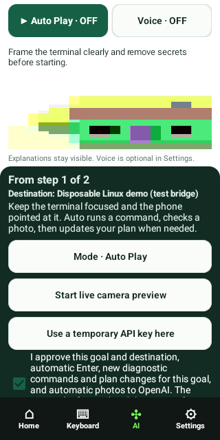
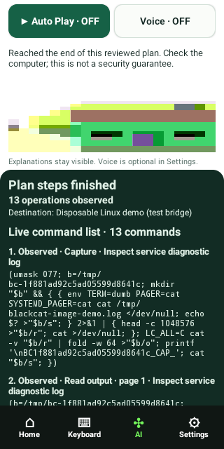

# Linux / image feedback loop

**Passed:** 13 distinct Linux operations, 14 image observations, one plan revision;
zero driver restarts, manual provider responses or command replays in this run.
The real instrumentation emitted `IMAGE_AUTO_DEMO_PASS`; both host and native
processes exited successfully. The host verified that both capture directories
had been removed.

1. The production sender's HID reports were decoded by the emulator-only target.
2. The disposable Linux driver executed the bounded log-capture wrapper.
3. An eight-line page was deliberately clipped. OCR read its footer; the app
   automatically changed to four-line pages of the same saved output.
4. Four pages delivered all 14 diagnostic lines, including the compatibility error.
5. After cleanup, the app reconciled the evidence and adopted the scripted plan's
   `cat /etc/os-release` diagnostic in place of `whoami`, without manual approval.
6. It captured/paginated the actual OS output, cleaned its files, and finished.

The `photo-*.jpg` files are rendered terminal images supplied at the **test observer
boundary**, after the phone captured and verified an actual emulated Camera2 JPEG.
They are not photographs from a physical camera or proof of video-camera stream
injection. Each terminal image came from actual Linux stdout. The separate
Tesseract provider read that JPEG, not stdout or expected page contents, and supplied
structured observations to the production codec. It compares the entire token and
numeric exit code, tolerates only underscore/whitespace segmentation, and never
repairs letters/digits from the context. Bounded OCR segmentation passes use one
consistent pass for a response; page bodies are not stitched across passes.

The plan provider is explicitly scripted for this demo and asserts that all log
pages reached its context. It is **not OpenAI**. Authentication, live model reasoning,
paid vision/audio, physical Bluetooth and handset optics remain untested here.
The bridge exists only in instrumentation/tools and is absent from the shipped APK.

Raw synthetic evidence is retained alongside this file: actual command journals
and stdout, observer JPEGs, selected OCR text/modes, request/reply JSON, visible plan
revisions, host/native logs, and [result.json](result.json). Earlier failed attempts
and the resulting UI14.1 timeout fix are described in the main verification report.
