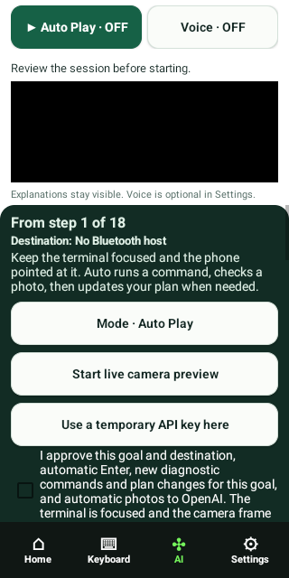
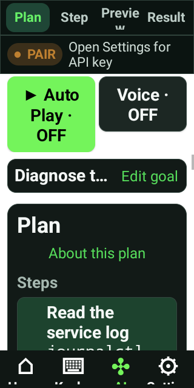
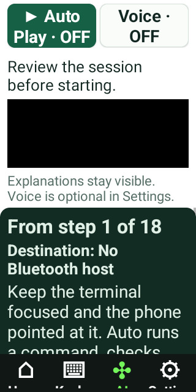
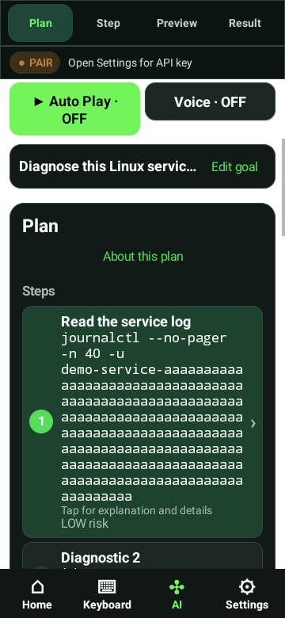
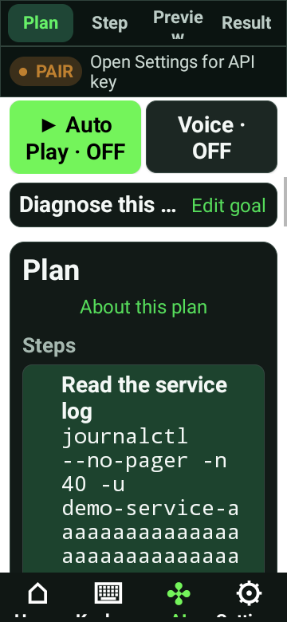
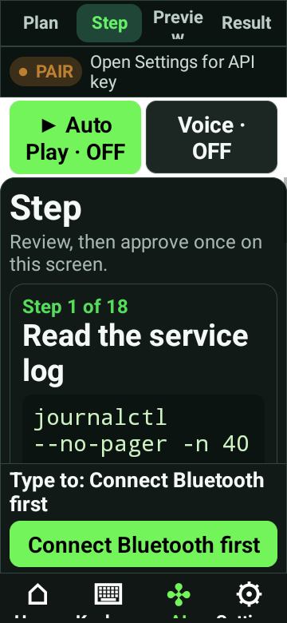
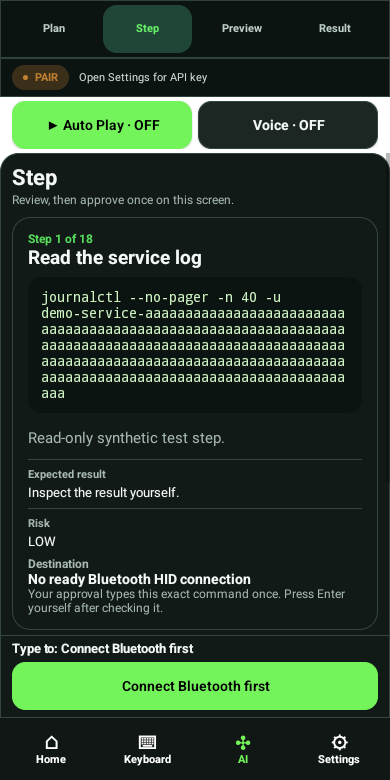
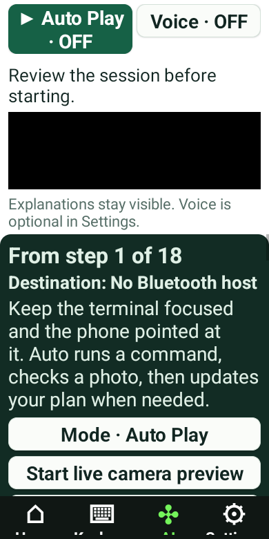
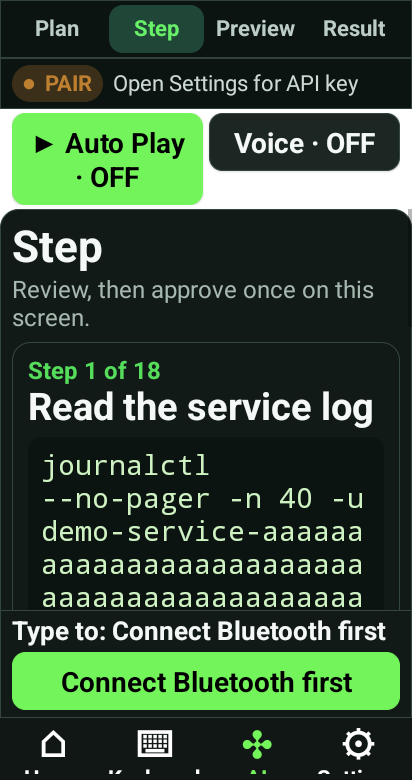

# Native width and font matrix

Android 12/API31 ATD. Real window captures; 320/360/390/412 dp and 100/130/200% text. All 26 geometry/navigation/icon checks passed against the published candidate APK. The 320 dp window is also height constrained. Long commands contain synthetic test identifiers.

[Candidate](../README.md) · [Test output](../verification/layout.log)

## Packaged launcher icon

## 320 dp / 100% text

## 320 dp / 130% text

## 320 dp / 200% text

## 360 dp / 100% text

## 360 dp / 130% text

## 360 dp / 200% text

## 390 dp / 100% text

## 390 dp / 130% text

## 390 dp / 200% text

## 412 dp / 100% text

## 412 dp / 130% text

## 412 dp / 200% text

