# Native UI14.1 screen gallery

Android 12/API31 ATD. Synthetic fixtures only; no physical Bluetooth, real account or live OpenAI response is represented. Opening/navigation checks are passive. Camera images below use the emulated camera.

[Candidate and verification](../README.md) · [Font/width matrix](../layout-matrix/README.md)

## Home

## Bluetooth off

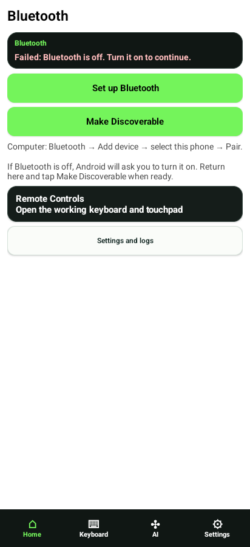

## Keyboard mouse

## Keyboard special keys

## Settings

## Settings key rejected

## Settings key verified

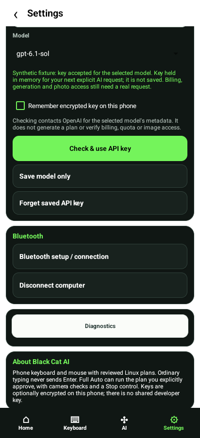

## Settings diagnostics

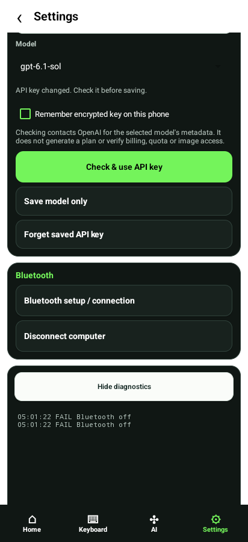

## Target system

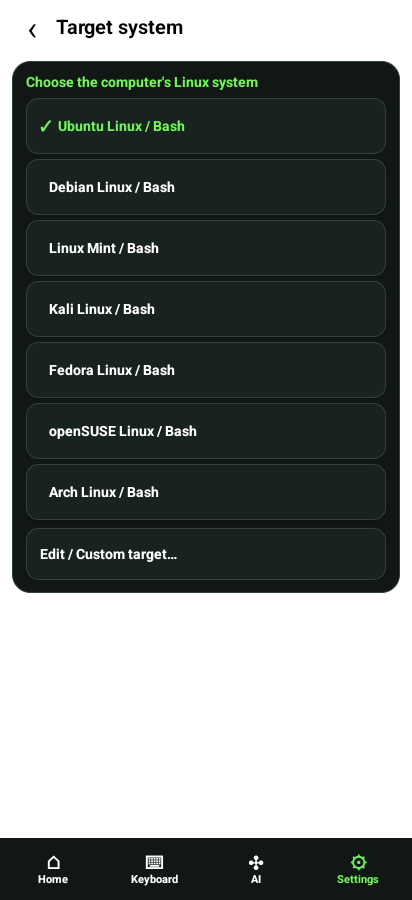

## Plan

## Plan steps

## Plan clarification

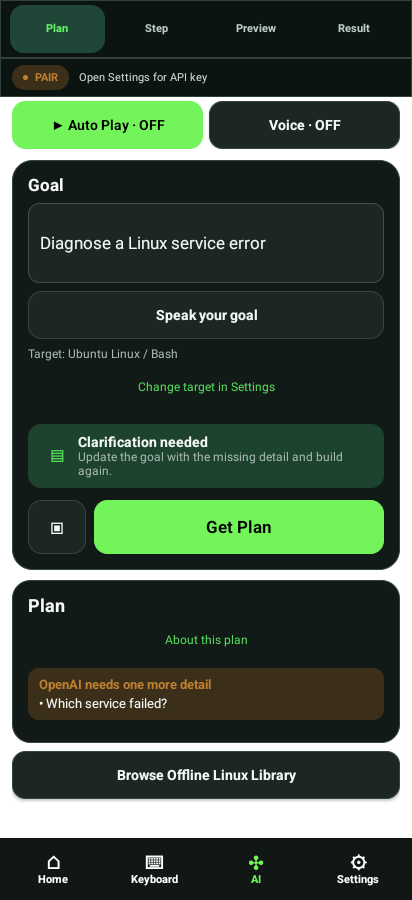

## Detailed roadmap expanded

## Single approval step

## Step

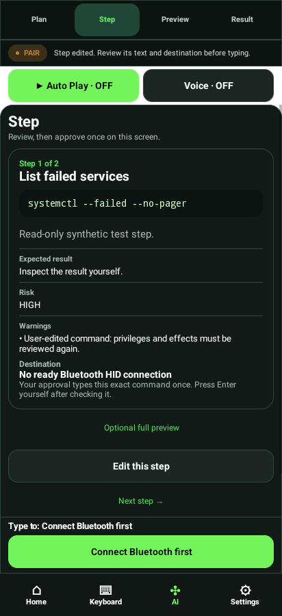

## Step editor

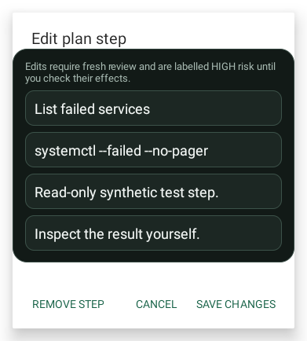

## Preview

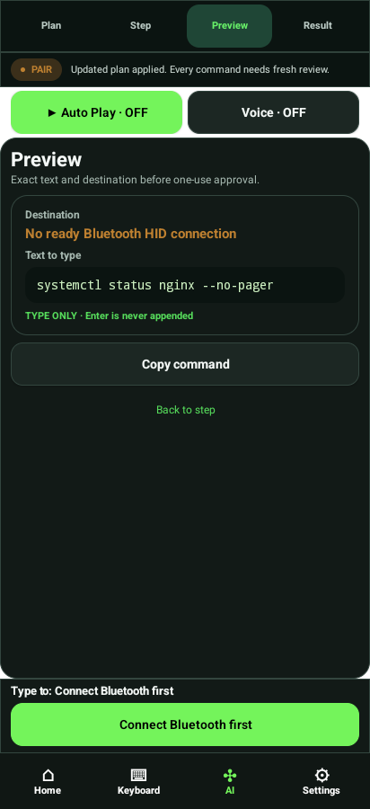

## Result

## Result feedback

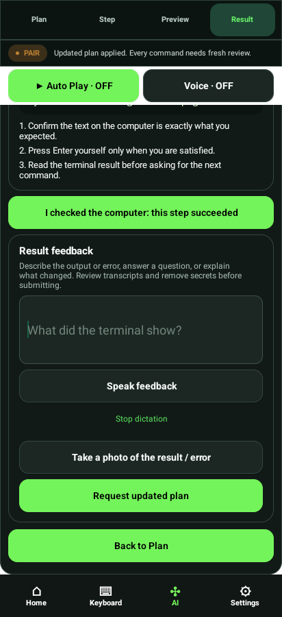

## Voice consent

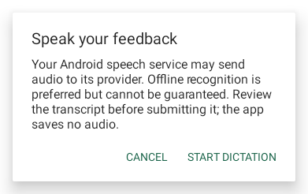

## Photo capture

## Photo review

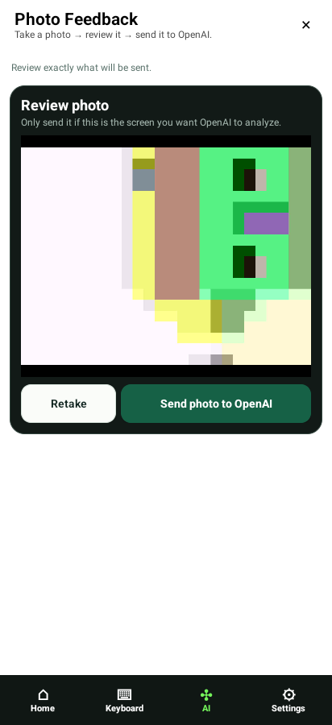

## Proposed update

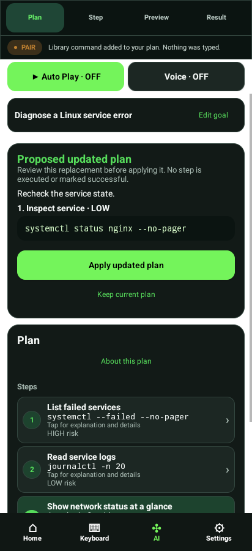

## Library categories

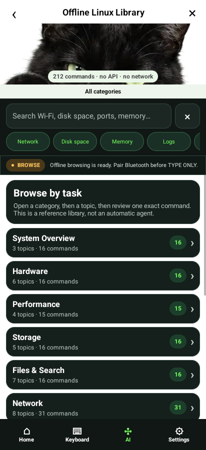

## Library topics

## Library commands

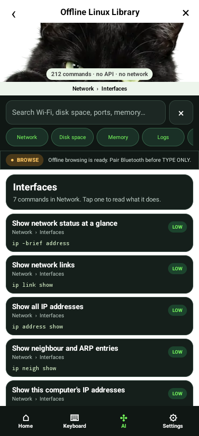

## Library detail

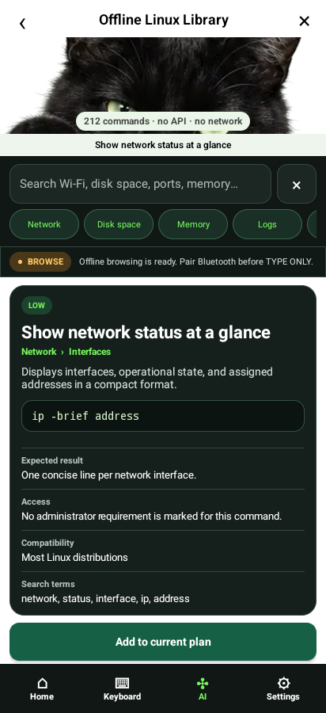

## Library search

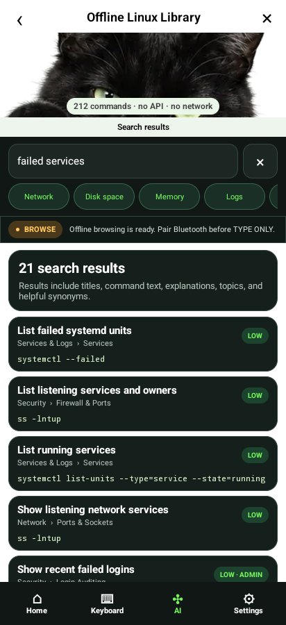

## Auto reviewed session

## Auto countdown

## Auto checking output

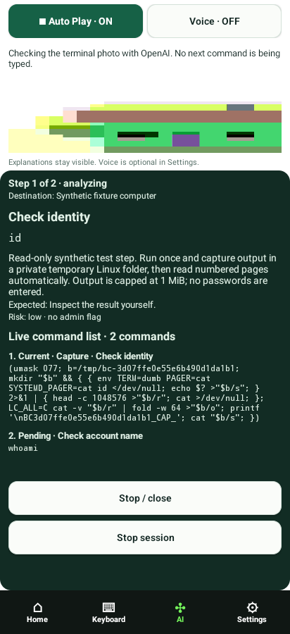

## Auto plan finished

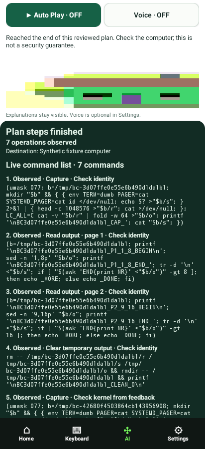

## Auto initial error

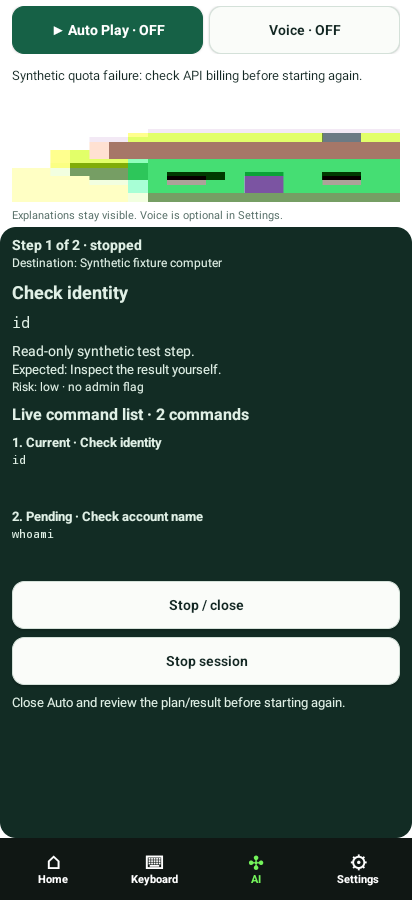

## Bluetooth

## Detailed plan 18 steps

## Keyboard text

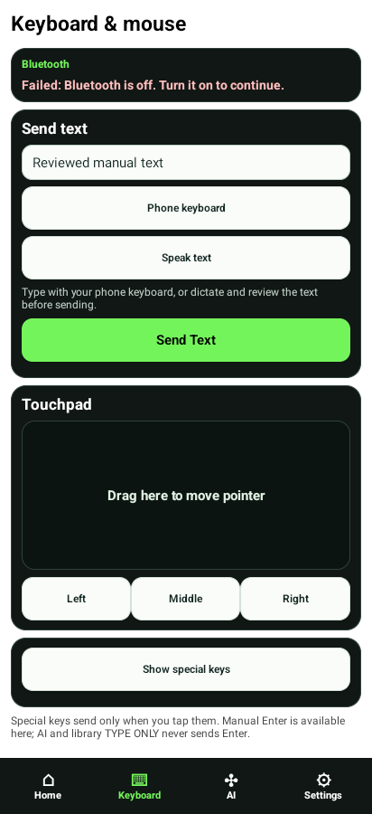

## Photo analysis

## Feedback timeout recovery

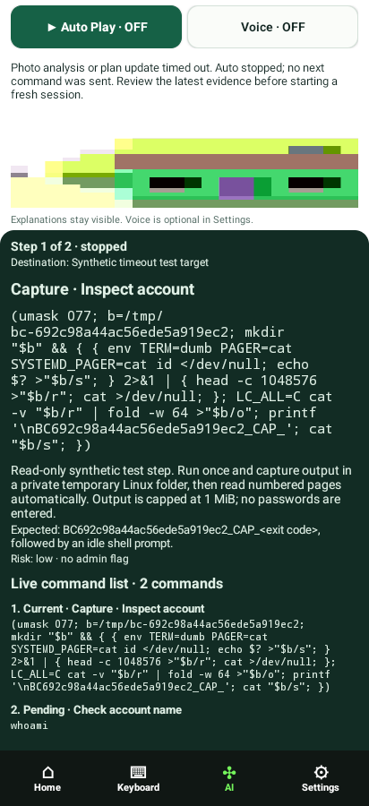
