# UI14.2 workflow screenshots

39 actual app-window PixelCopy captures from the exact version-18 APK. Synthetic provider/HID fixtures only; Camera2 capture and Android rendering are real on the API31 ATD emulator. Live host OpenAI tests are documented separately.

The pinned Cancel regression is [shown here](long-request-cancel.png). It seeds a busy Results state with the goal collapsed, then verifies visible cancellation retains the plan; it does not run a live phone-network request.

[Auto Checking Output](auto-checking-output.png)

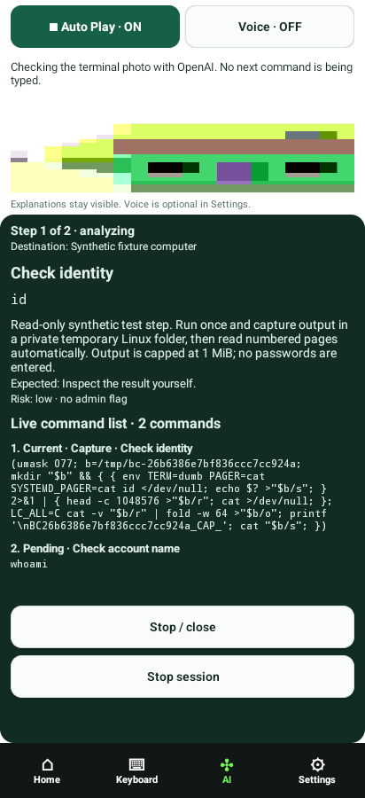

[Auto Countdown](auto-countdown.png)

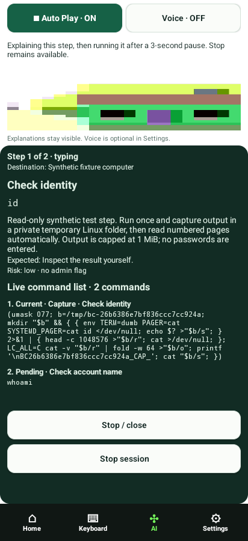

[Auto Feedback Timeout](auto-feedback-timeout.png)

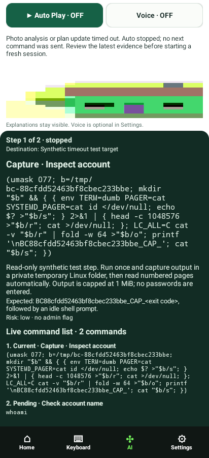

[Auto Initial Error](auto-initial-error.png)

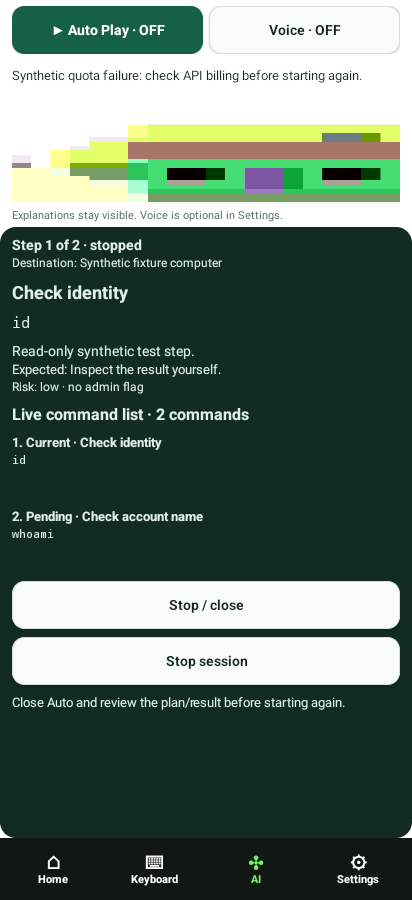

[Auto Plan Finished](auto-plan-finished.png)

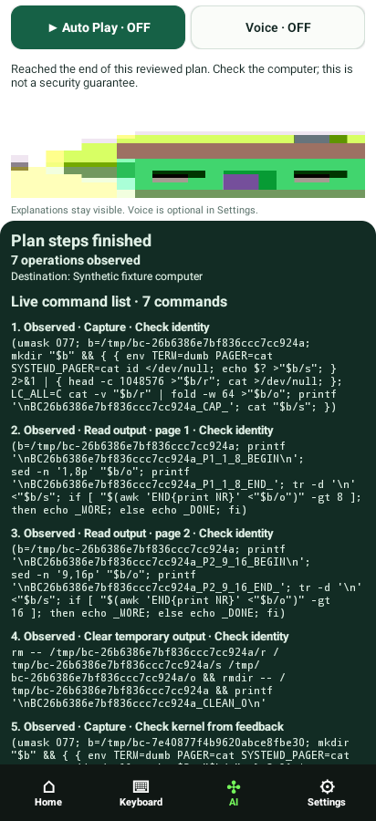

[Auto Reviewed Session](auto-reviewed-session.png)

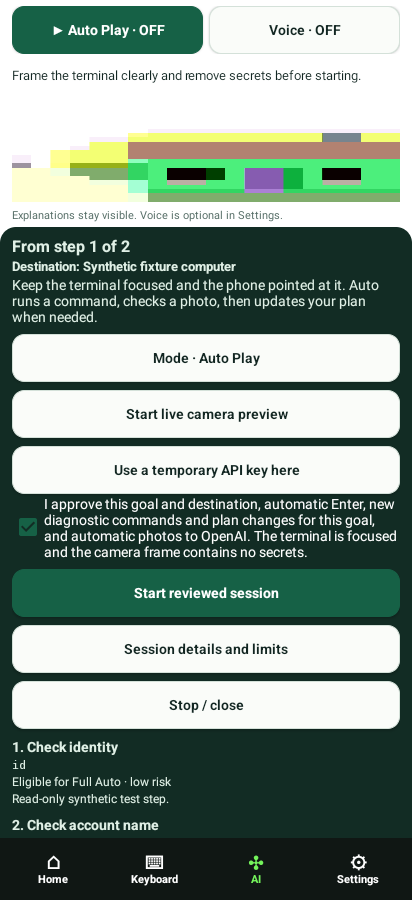

[Bluetooth Off](bluetooth-off.png)

[Bluetooth](bluetooth.png)

[Detailed Plan 18 Steps](detailed-plan-18-steps.png)

[Detailed Roadmap Expanded](detailed-roadmap-expanded.png)

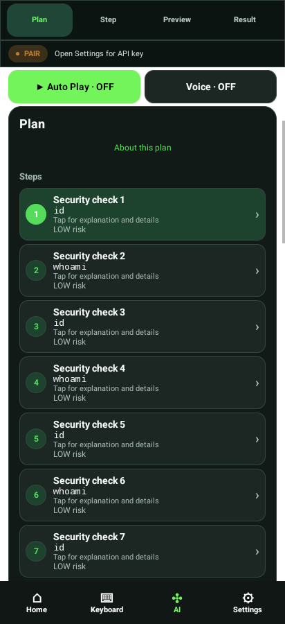

[Home](home.png)

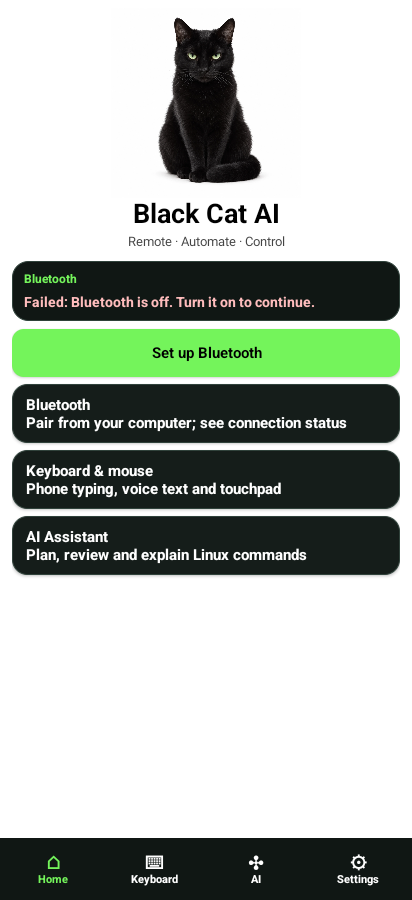

[Keyboard Mouse](keyboard-mouse.png)

[Keyboard Special Keys](keyboard-special-keys.png)

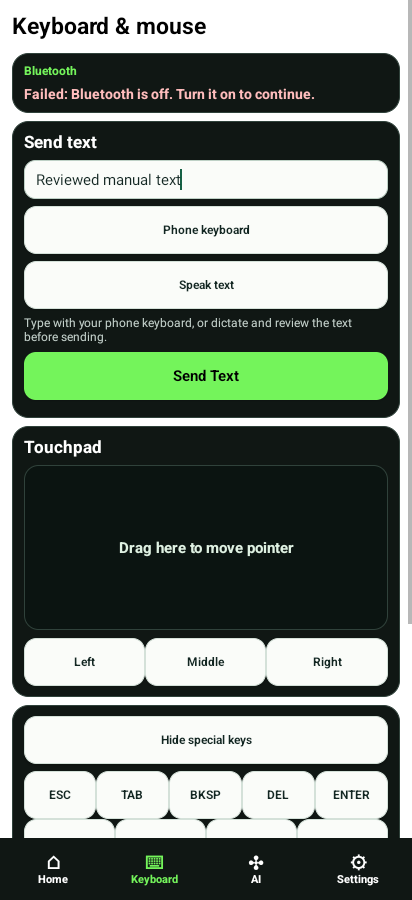

[Keyboard Text](keyboard-text.png)

[Library Categories](library-categories.png)

[Library Commands](library-commands.png)

[Library Detail](library-detail.png)

[Library Search](library-search.png)

[Library Topics](library-topics.png)

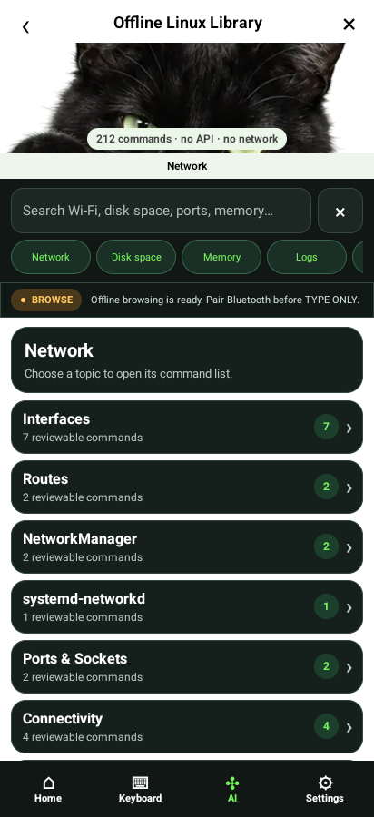

[Long Request Cancel](long-request-cancel.png)

[Photo Analysis](photo-analysis.png)

[Photo Capture](photo-capture.png)

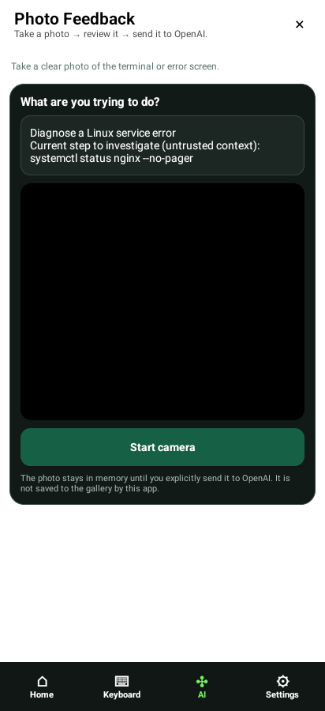

[Photo Review](photo-review.png)

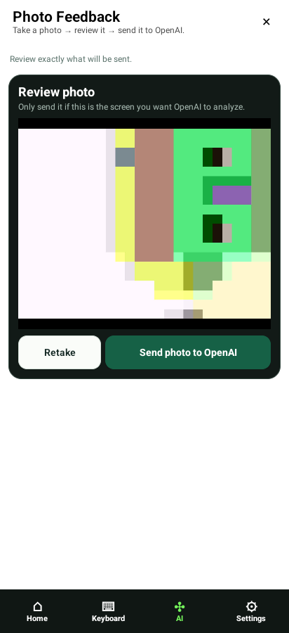

[Plan Clarification](plan-clarification.png)

[Plan Steps](plan-steps.png)

[Plan](plan.png)

[Preview](preview.png)

[Proposed Update](proposed-update.png)

[Result Feedback](result-feedback.png)

[Result](result.png)

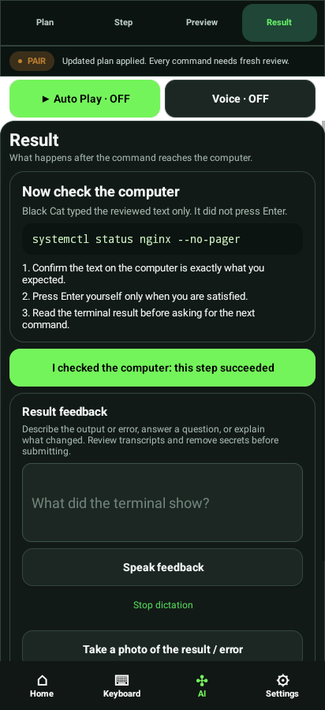

[Settings Diagnostics](settings-diagnostics.png)

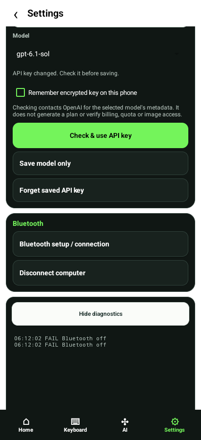

[Settings Key Rejected](settings-key-rejected.png)

[Settings Key Verified](settings-key-verified.png)

[Settings](settings.png)

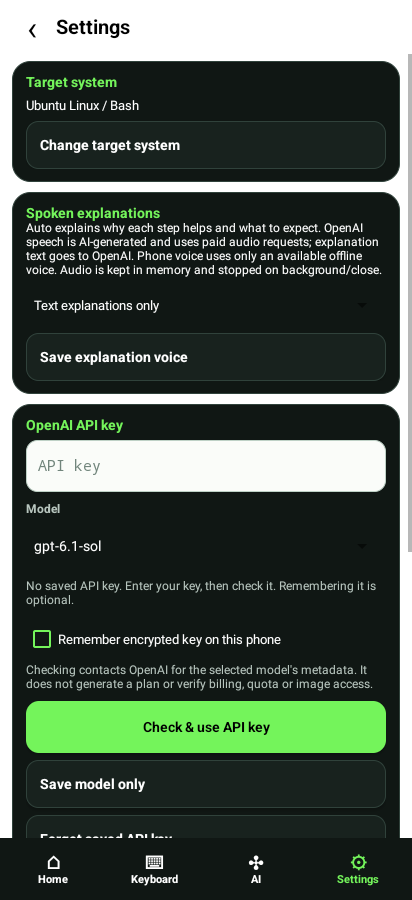

[Single Approval Step](single-approval-step.png)

[Step Editor](step-editor.png)

[Step](step.png)

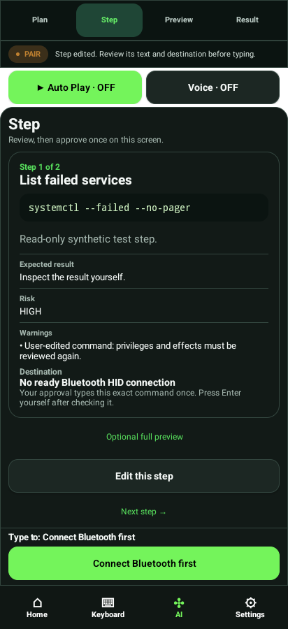

[Target System](target-system.png)

[Voice Consent](voice-consent.png)

