# Native emulator captures

Actual PixelCopy output from the exact candidate APK on an API31 software emulator.
Synthetic goals/providers; not evidence of physical Bluetooth or a continuous live API run.

## learning-01-home

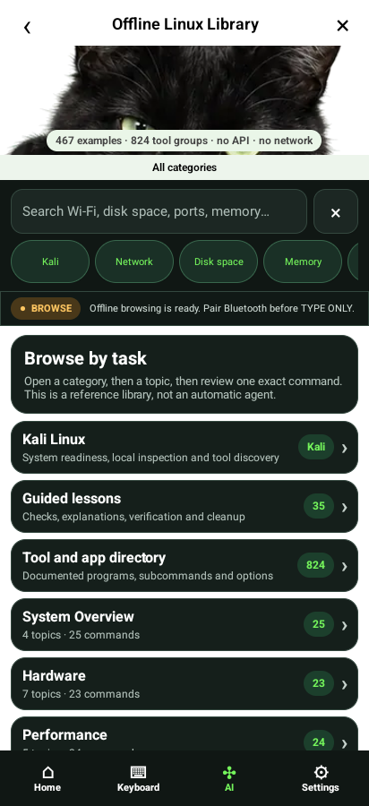

## learning-02-kali

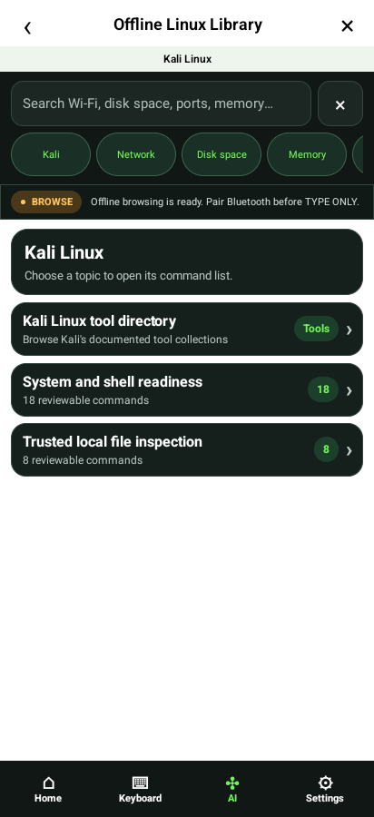

## learning-03-tools

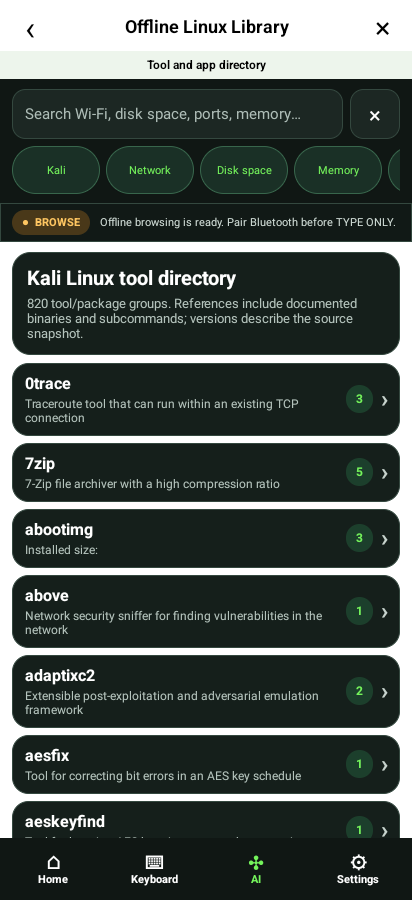

## learning-04-page-two

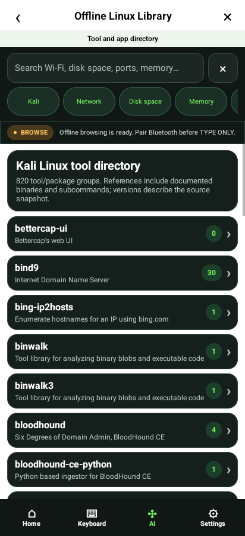

## learning-05-tool-source

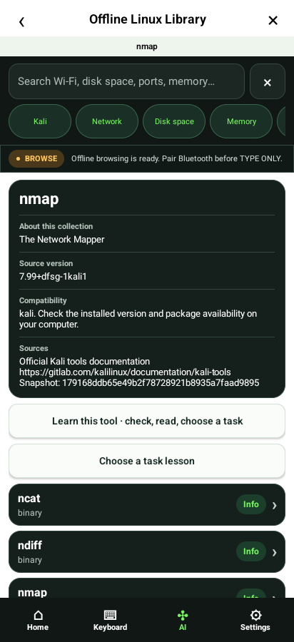

## learning-06-tool-guide

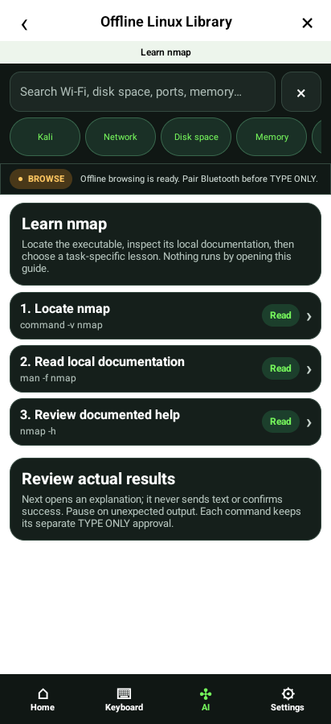

## learning-07-tool-next

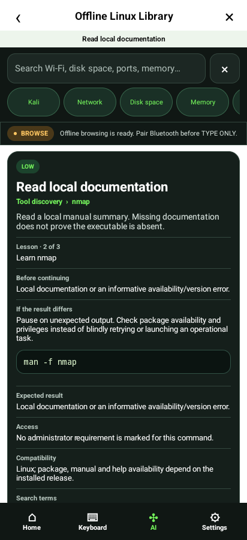

## learning-08-command-reference

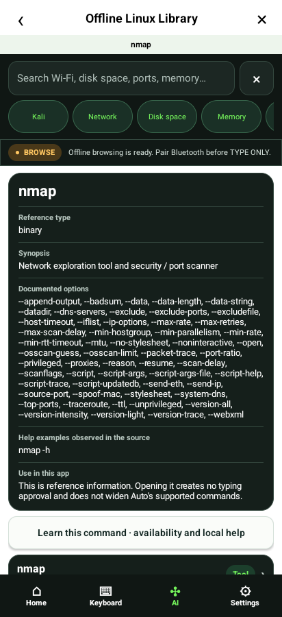

## learning-09-lesson-overview

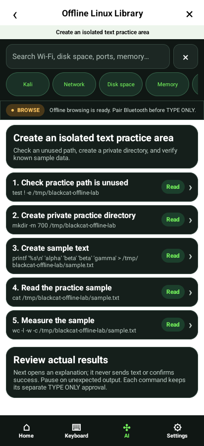

## learning-10-next-explanation

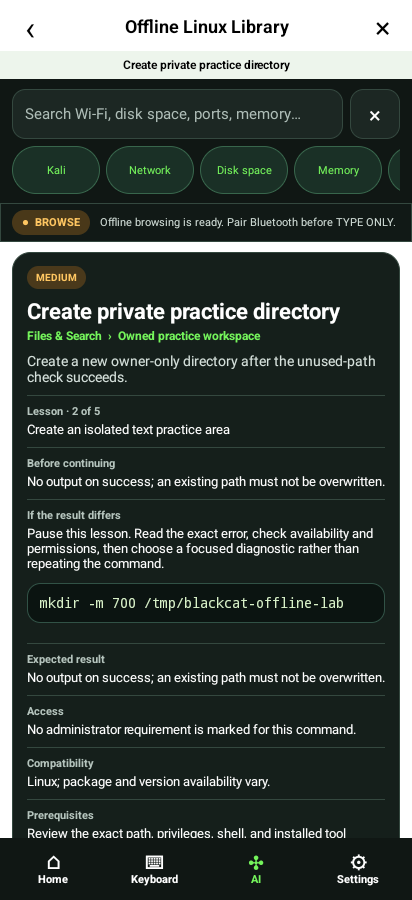

## learning-matrix-320-100-approval

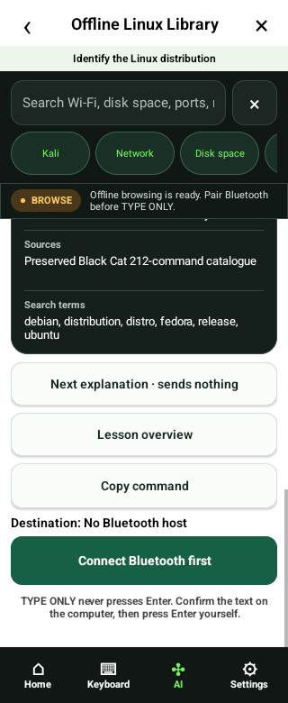

## learning-matrix-320-100-overview

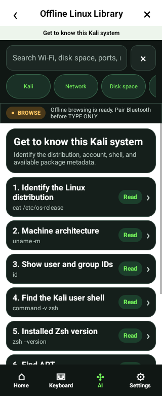

## learning-matrix-320-100-step

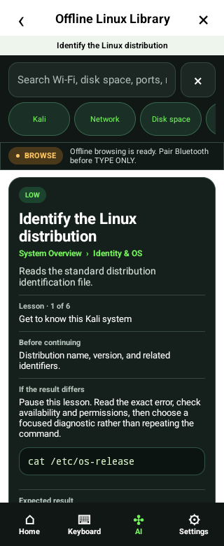

## learning-matrix-320-200-approval

## learning-matrix-320-200-overview

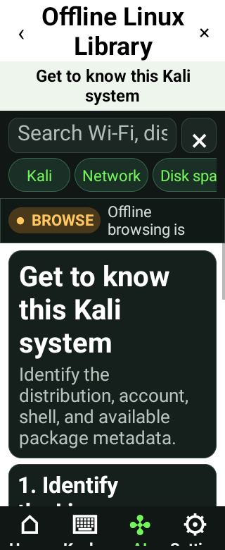

## learning-matrix-320-200-step

## learning-matrix-412-100-approval

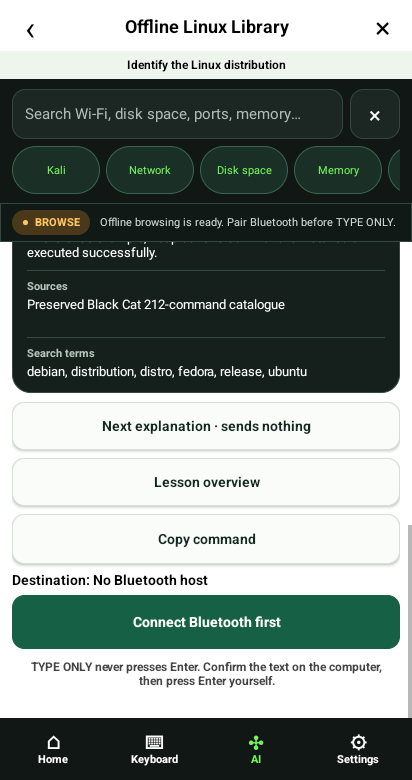

## learning-matrix-412-100-overview

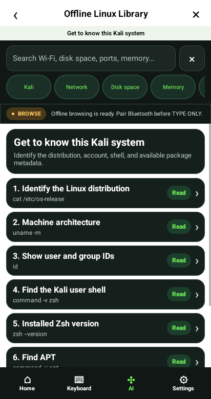

## learning-matrix-412-100-step

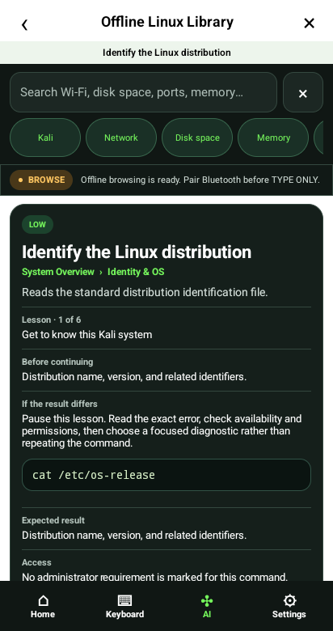

## learning-matrix-412-200-approval

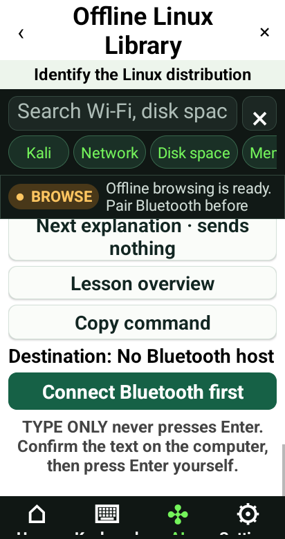

## learning-matrix-412-200-overview

## learning-matrix-412-200-step

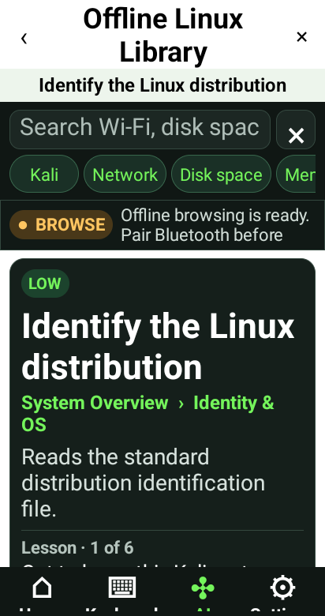
