# Native emulator captures

Actual PixelCopy output from the exact candidate APK on an API31 software emulator.
Synthetic goals/providers; not evidence of physical Bluetooth or a continuous live API run.

## auto-checking-output

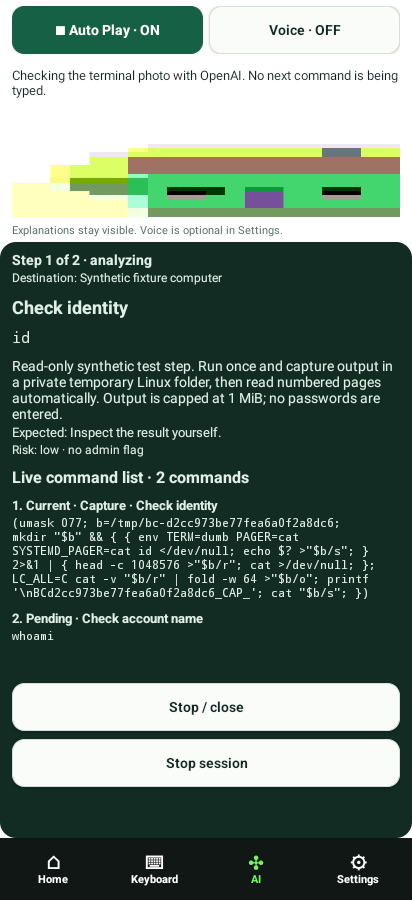

## auto-countdown

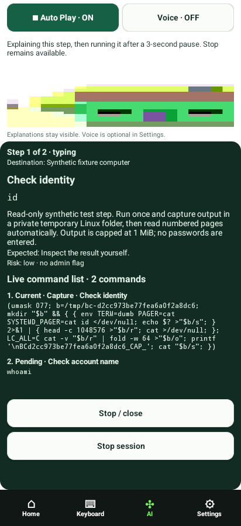

## auto-feedback-timeout

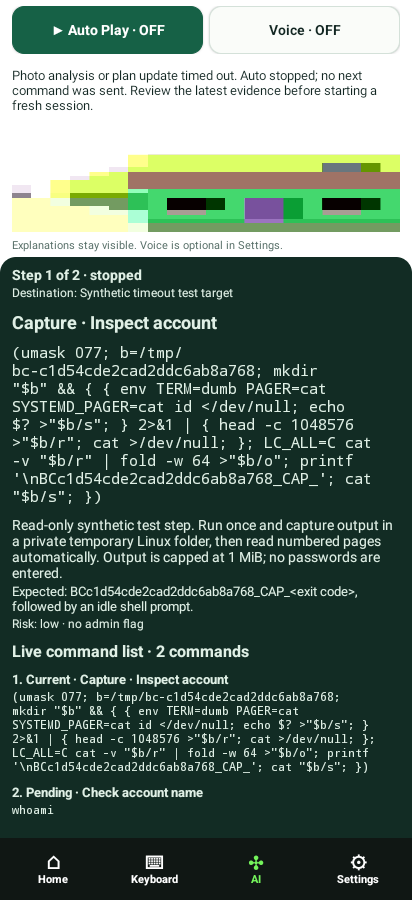

## auto-initial-error

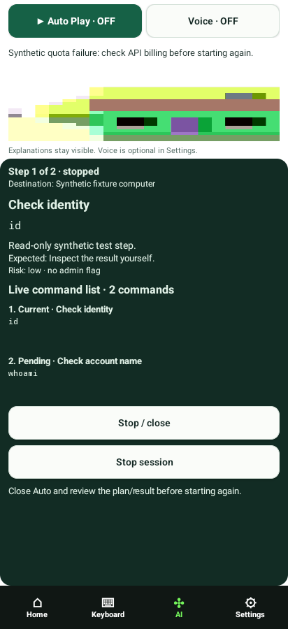

## auto-plan-finished

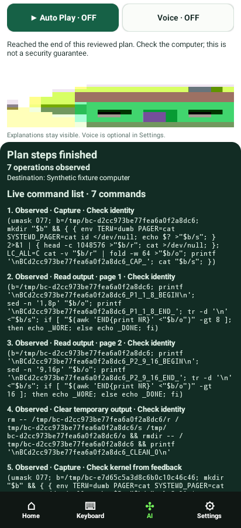

## auto-reviewed-session

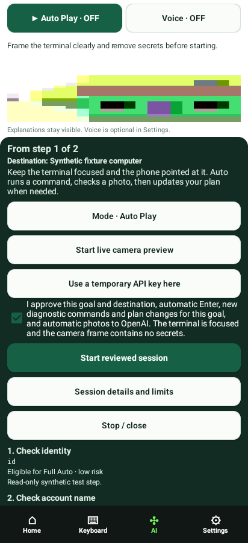

## bluetooth-off

## bluetooth

## detailed-plan-18-steps

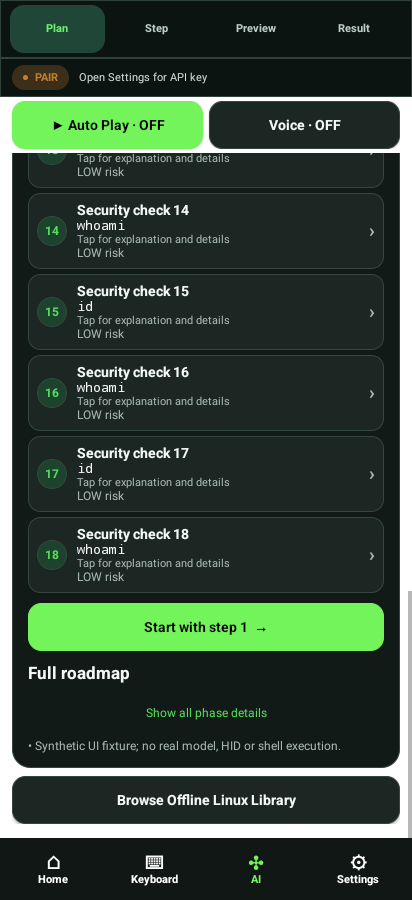

## detailed-roadmap-expanded

## home

## keyboard-mouse

## keyboard-special-keys

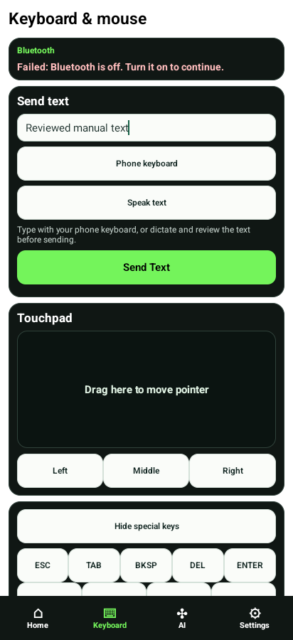

## keyboard-text

## library-categories

## library-commands

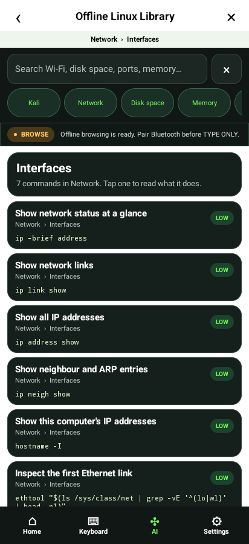

## library-detail

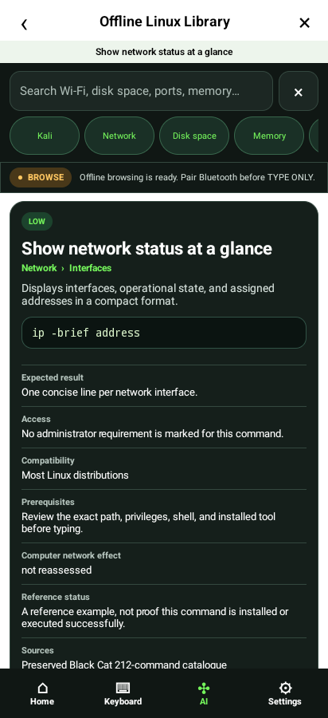

## library-search

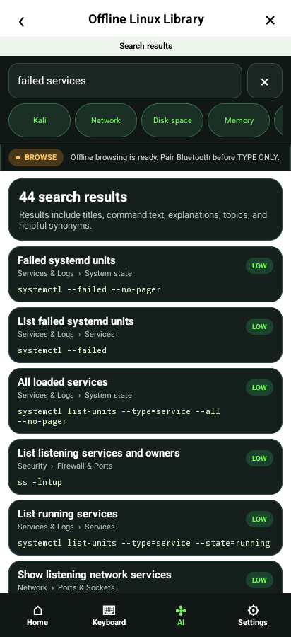

## library-topics

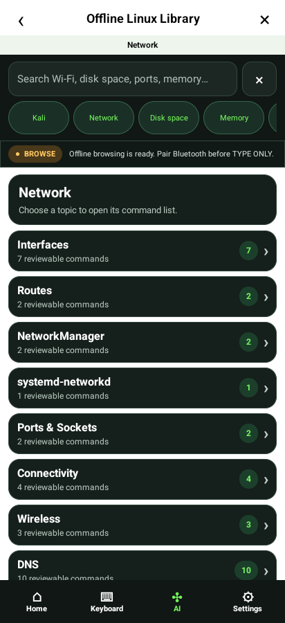

## long-request-cancel

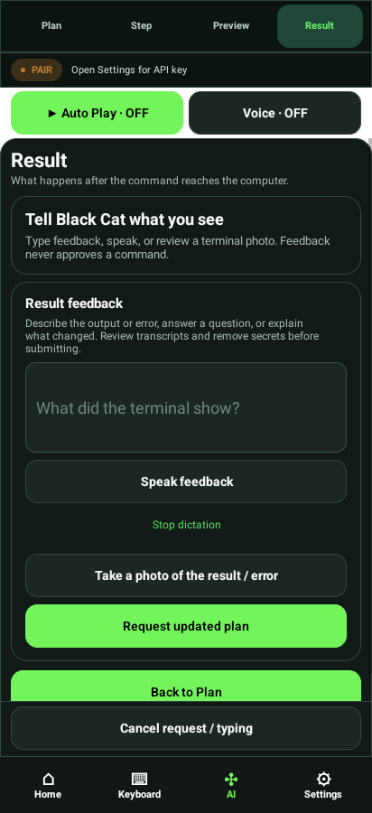

## photo-analysis

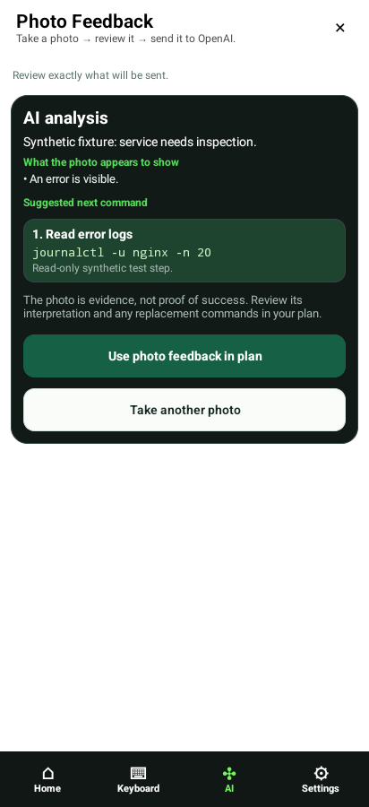

## photo-capture

## photo-review

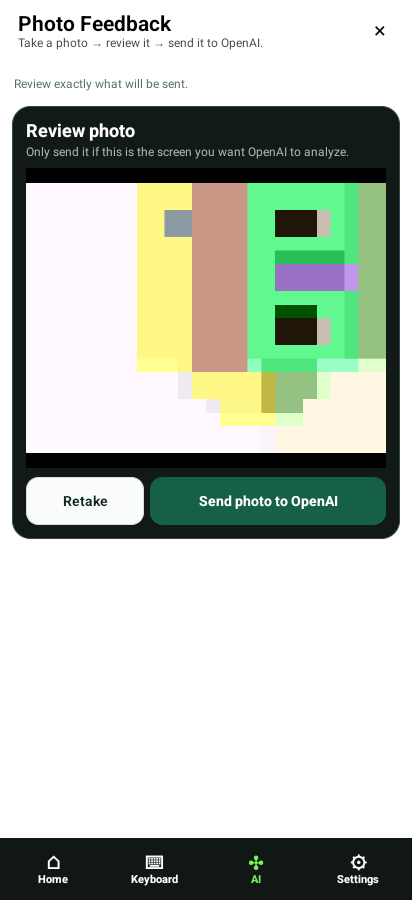

## plan-clarification

## plan-steps

## plan

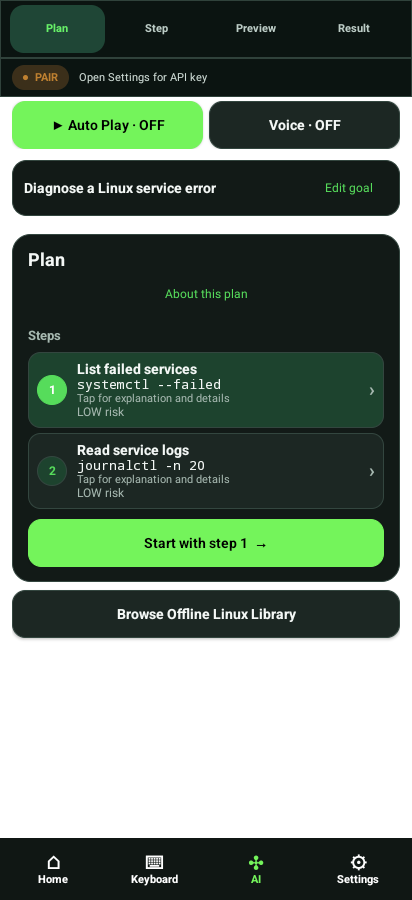

## preview

## proposed-update

## result-feedback

## result

## settings-diagnostics

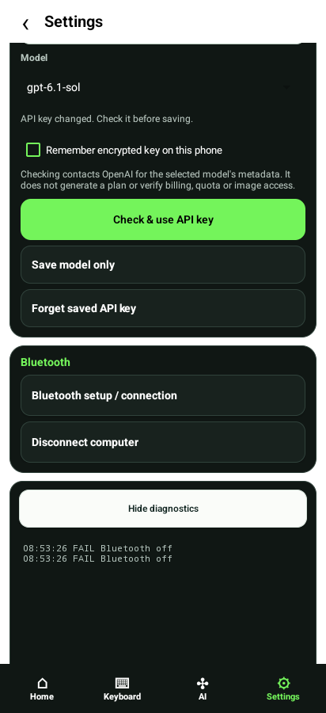

## settings-key-rejected

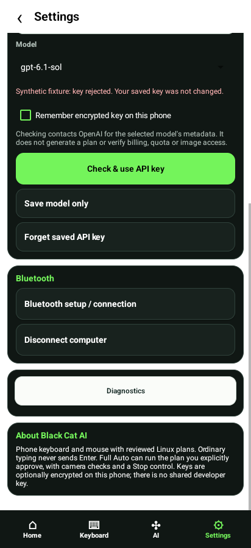

## settings-key-verified

## settings

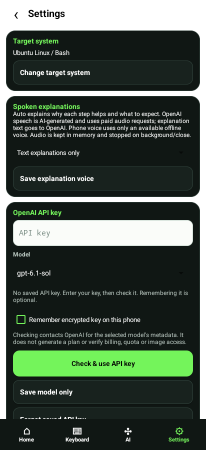

## single-approval-step

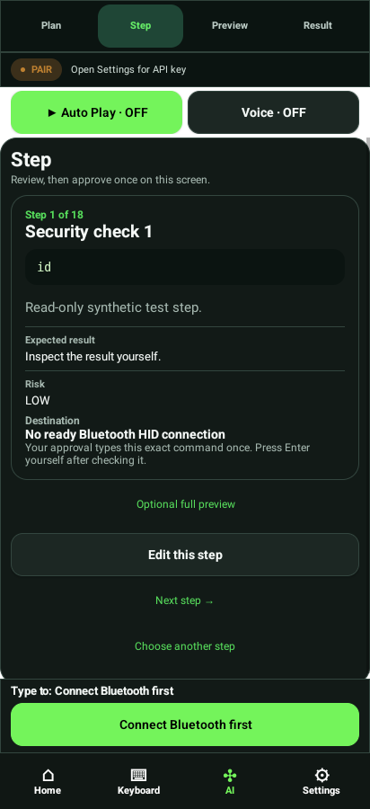

## step-editor

## step

## target-system

## voice-consent

