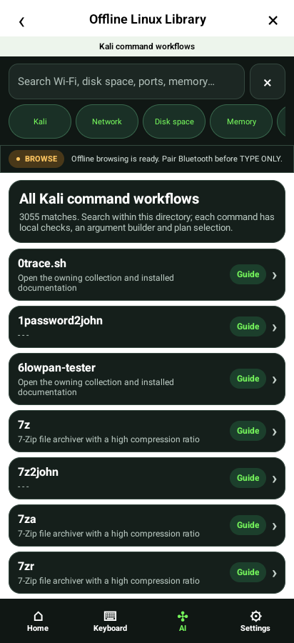
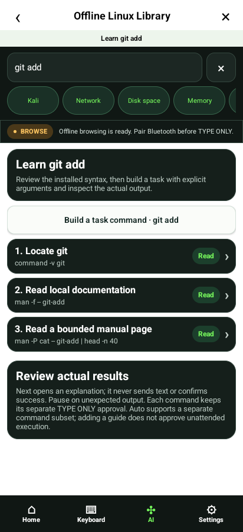
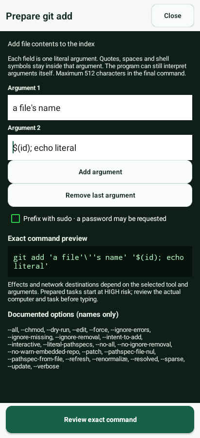
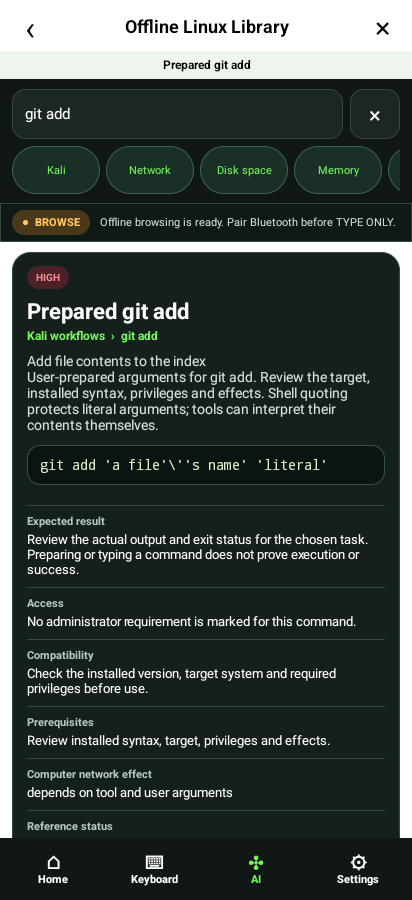
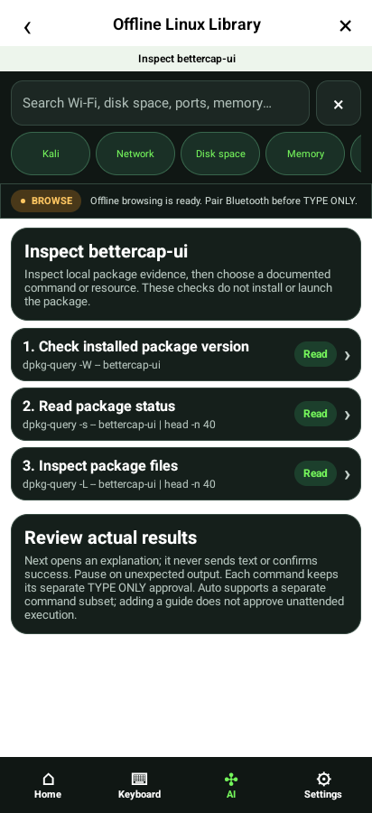
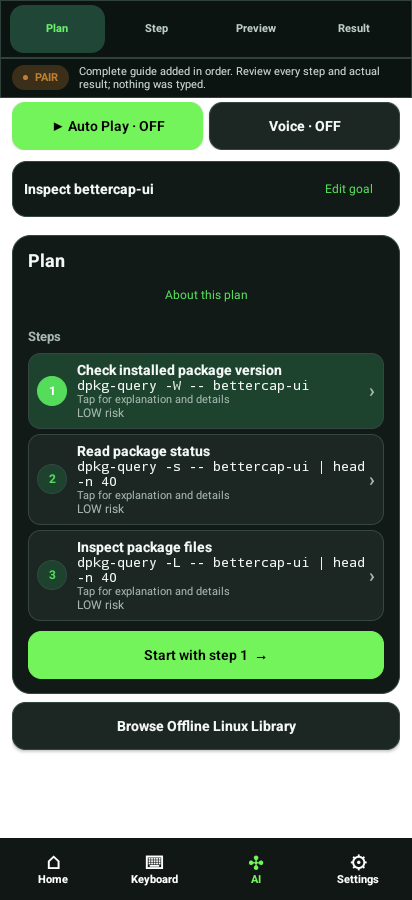
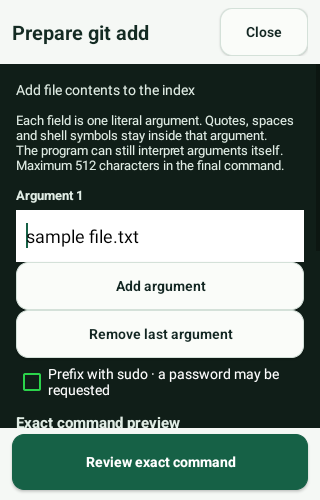
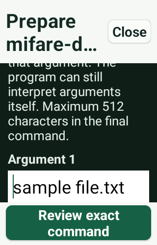

# Native emulator captures

Actual PixelCopy output from the exact candidate APK on an API31 software emulator.
Synthetic goals/providers; not evidence of physical Bluetooth or a continuous live API run.
The shell-symbol text in the editor is a deliberate literal-argument test; it is not executed.

## workflows-01-kali-command-list

## workflows-02-subcommand-guide

## workflows-03-literal-argument-builder

## workflows-04-prepared-command

## workflows-05-package-only-guide

## workflows-06-guide-in-plan

## workflows-matrix-320-100

## workflows-matrix-320-200

## workflows-matrix-412-100

## workflows-matrix-412-200

