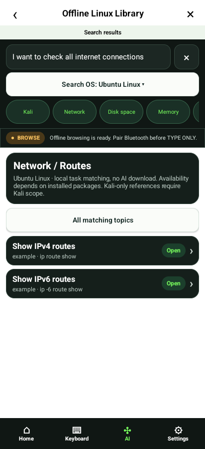
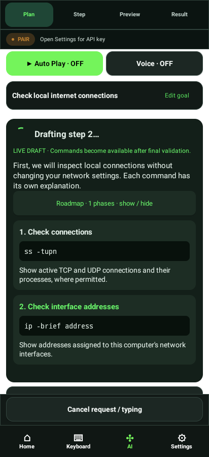
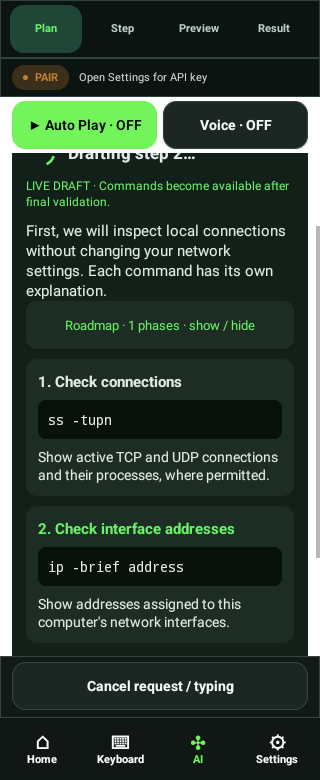
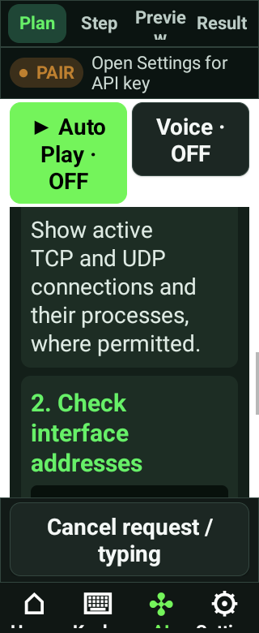
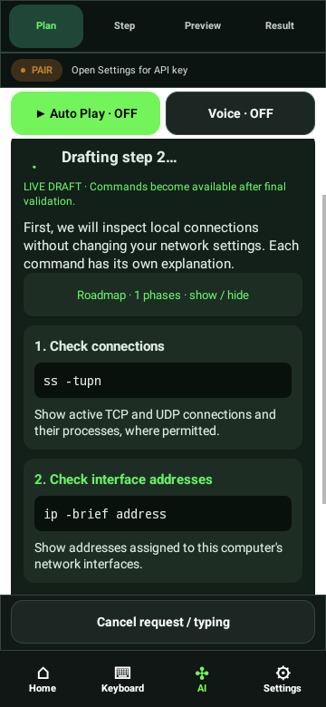
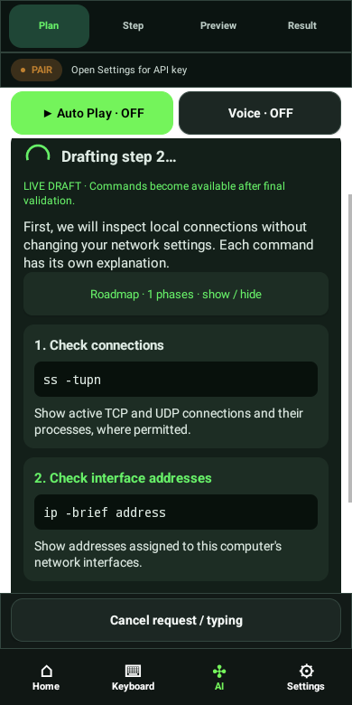
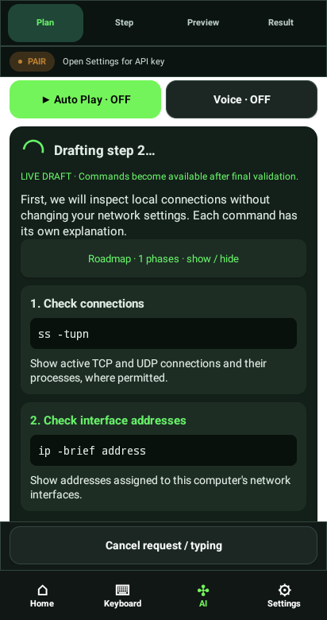

# Native emulator captures

Actual PixelCopy output from the exact candidate APK on an API31 software emulator.
Synthetic goals/providers; not evidence of physical Bluetooth or a continuous live API run.

## search-stream-01-topics

## search-stream-02-topic-commands

## search-stream-03-kali-scope

## search-stream-04-live-draft

## search-stream-05-validated-plan

## search-stream-matrix-320-100

## search-stream-matrix-320-200

## search-stream-matrix-360-100

## search-stream-matrix-360-200

## search-stream-matrix-390-100

## search-stream-matrix-390-200

## search-stream-matrix-412-100

## search-stream-matrix-412-200

