# Native emulator screenshots

Earlier UI-identical candidate: source 5dc08a9, APK 9b3ef1a5c0cad9b5892f43328e649c2839539f6ddc6d49d6e414c1fd861f247f. The final production change affects only the observation decoder; these are not captures of the final APK. Actual PixelCopy captures. Synthetic providers/HID; physical testing remains.

## launcher-icon

## matrix-320-100-auto

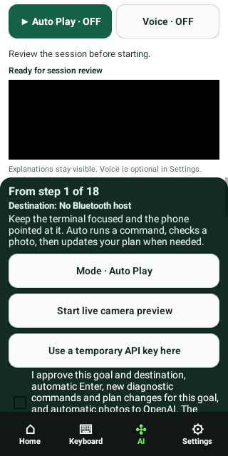

## matrix-320-100-plan

## matrix-320-100-step

## matrix-320-130-auto

## matrix-320-130-plan

## matrix-320-130-step

## matrix-320-200-auto

## matrix-320-200-plan

## matrix-320-200-step

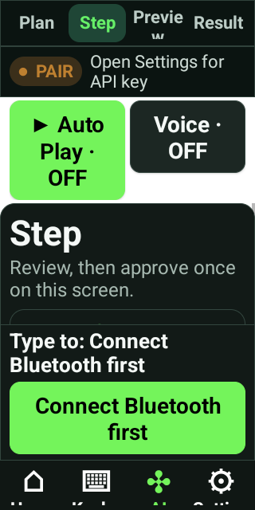

## matrix-360-100-auto

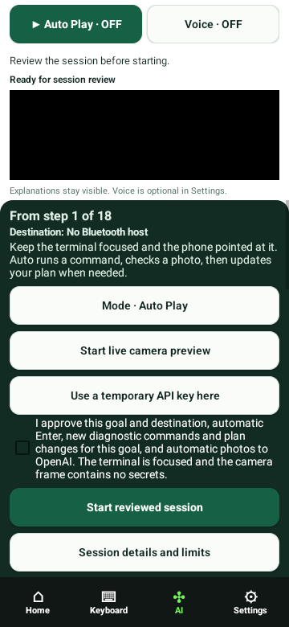

## matrix-360-100-plan

## matrix-360-100-step

## matrix-360-130-auto

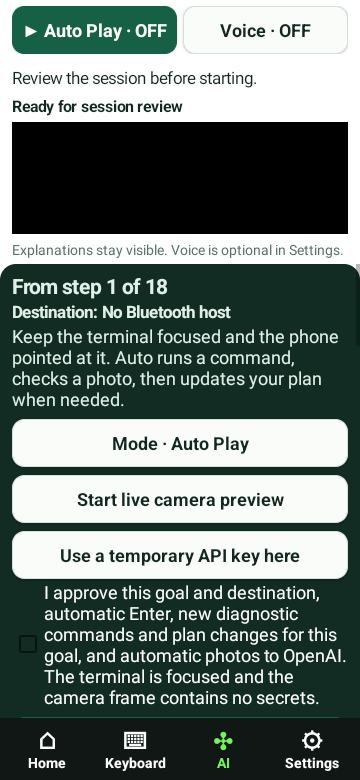

## matrix-360-130-plan

## matrix-360-130-step

## matrix-360-200-auto

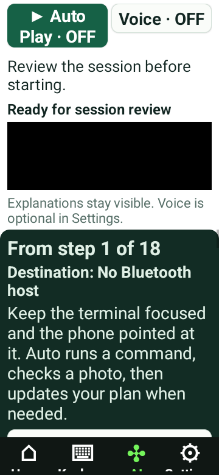

## matrix-360-200-plan

## matrix-360-200-step

## matrix-390-100-auto

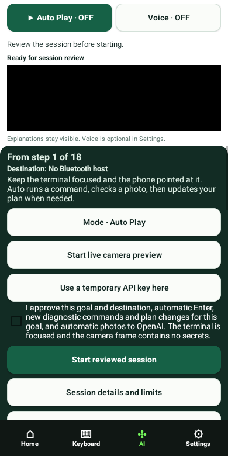

## matrix-390-100-plan

## matrix-390-100-step

## matrix-390-130-auto

## matrix-390-130-plan

## matrix-390-130-step

## matrix-390-200-auto

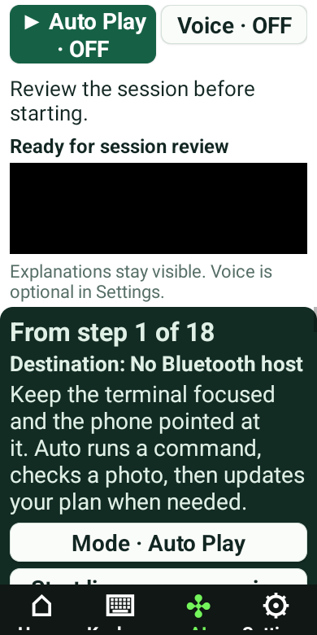

## matrix-390-200-plan

## matrix-390-200-step

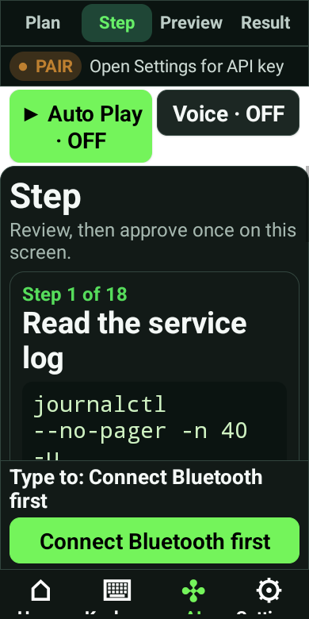

## matrix-412-100-auto

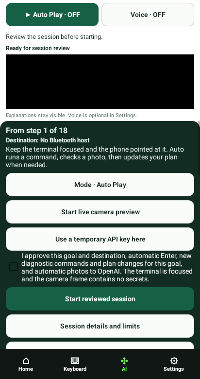

## matrix-412-100-plan

## matrix-412-100-step

## matrix-412-130-auto

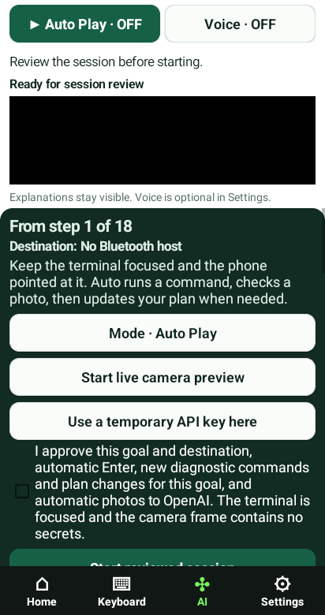

## matrix-412-130-plan

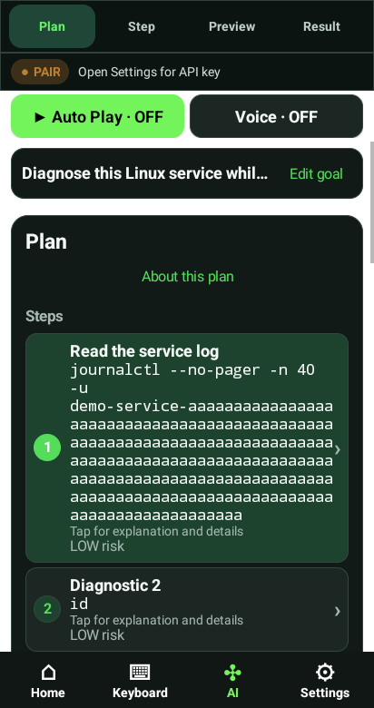

## matrix-412-130-step

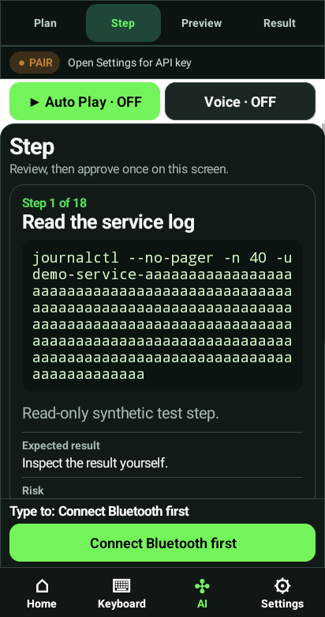

## matrix-412-200-auto

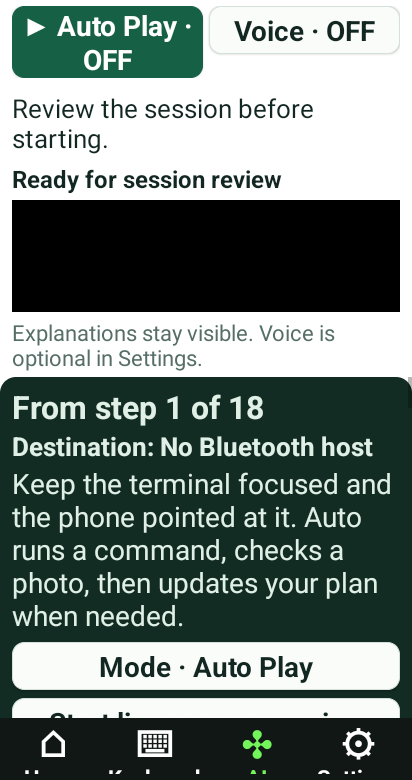

## matrix-412-200-plan

## matrix-412-200-step

