# Actual Linux / independent OCR image demonstration

Final APK; actual Linux output, independently read by Tesseract. The test driver supplies scripted planning and injects rendered terminal frames at the observer boundary; real Camera2 lifecycle/JPEG capture still runs. No physical Bluetooth or live app-network proof. Full printed capture/cleanup footer variants exercise the final decoder.

## 01-camera-ready

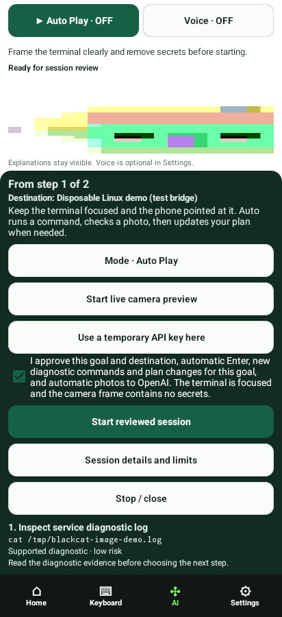

## 02-plan-finished

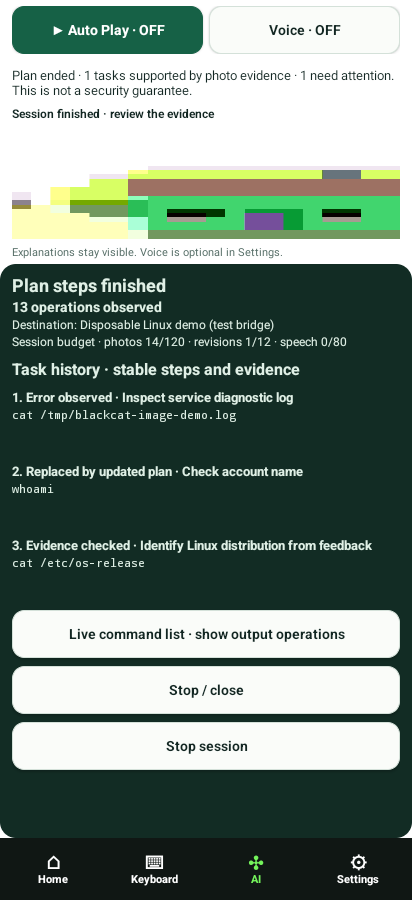

## command-001-terminal

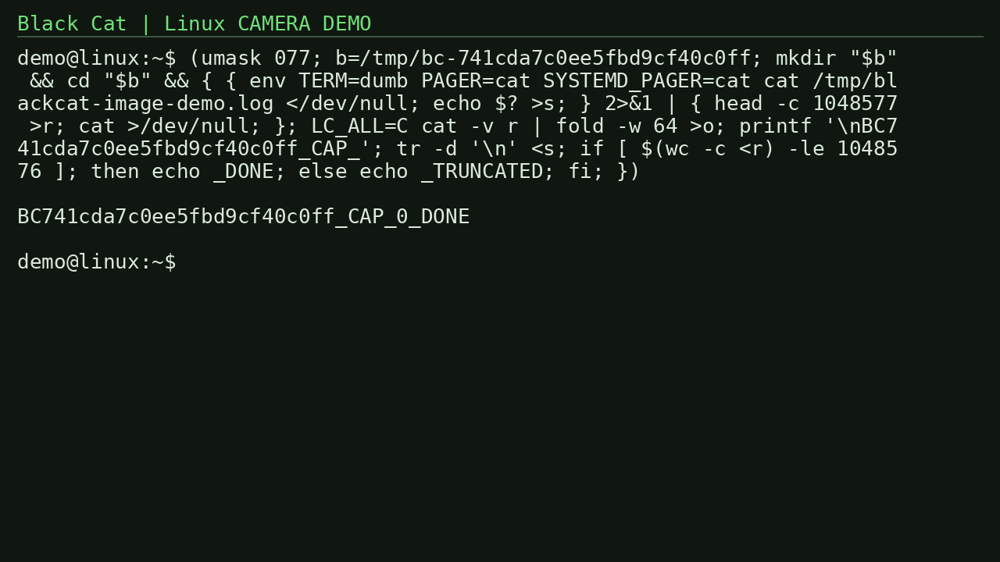

## command-002-terminal

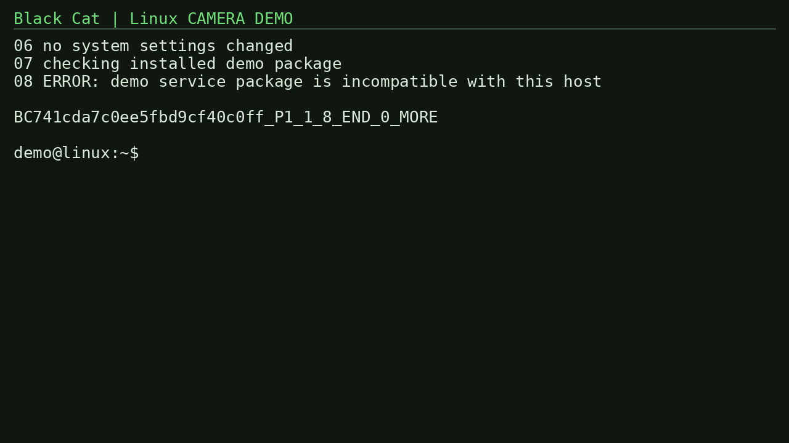

## command-003-terminal

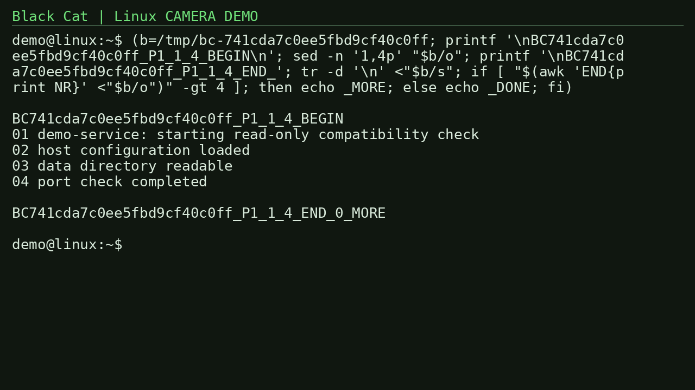

## command-004-terminal

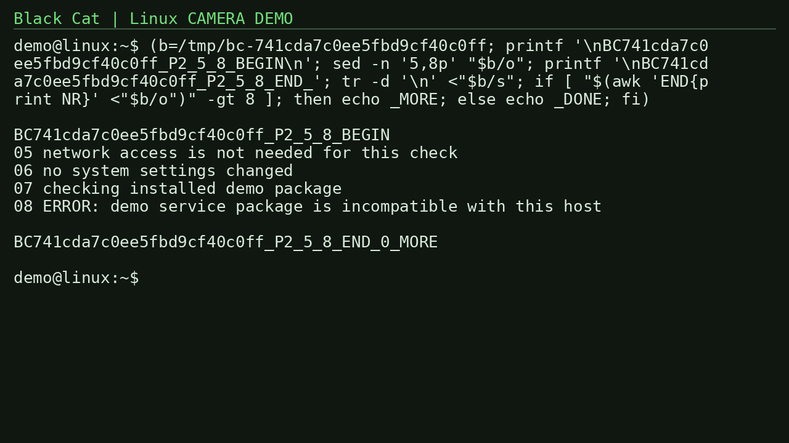

## command-005-terminal

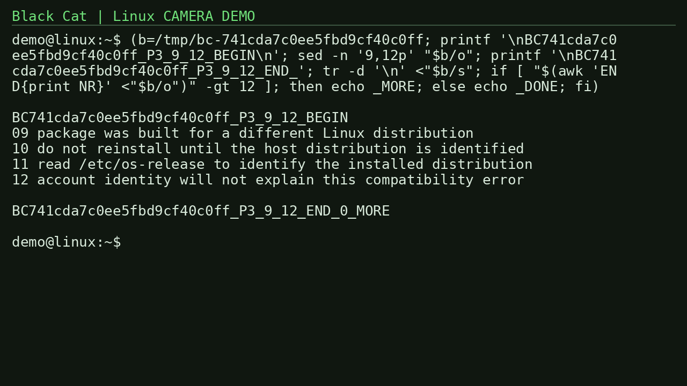

## command-006-terminal

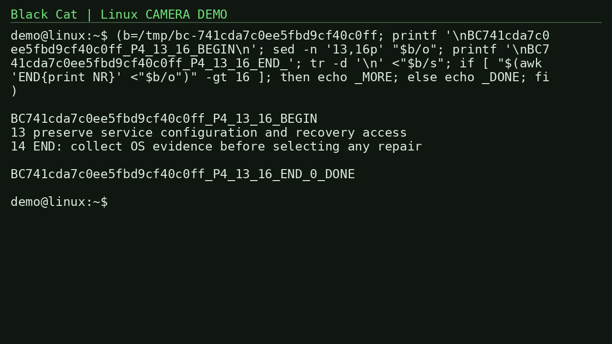

## command-007-terminal

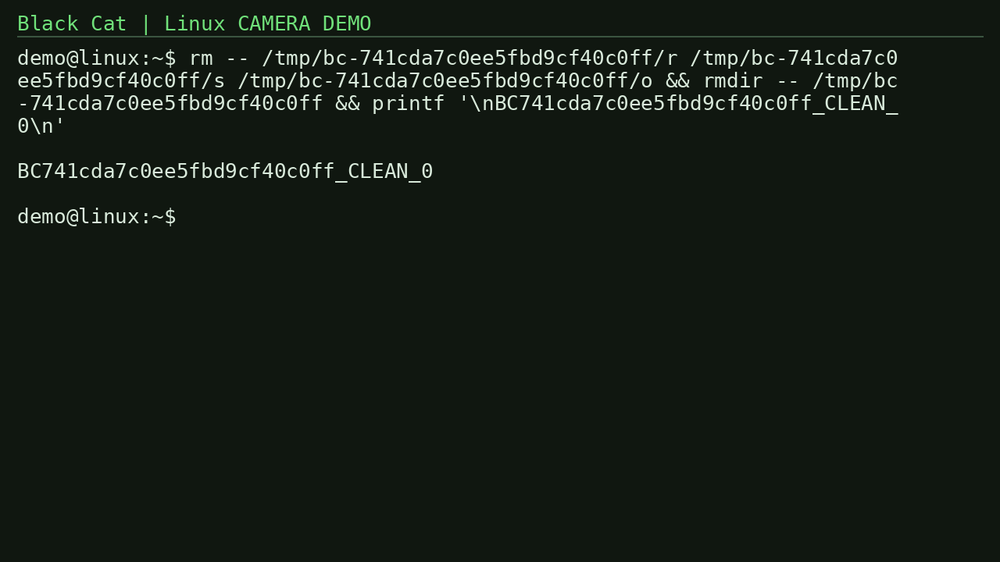

## command-008-terminal

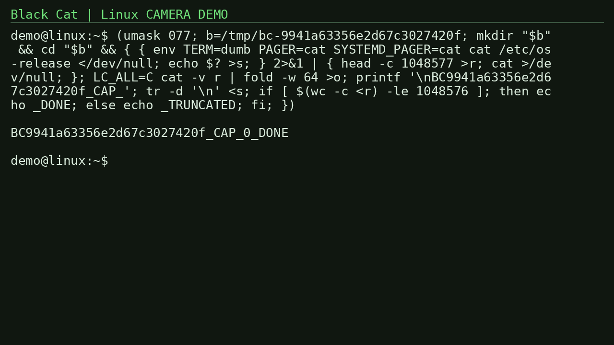

## command-009-terminal

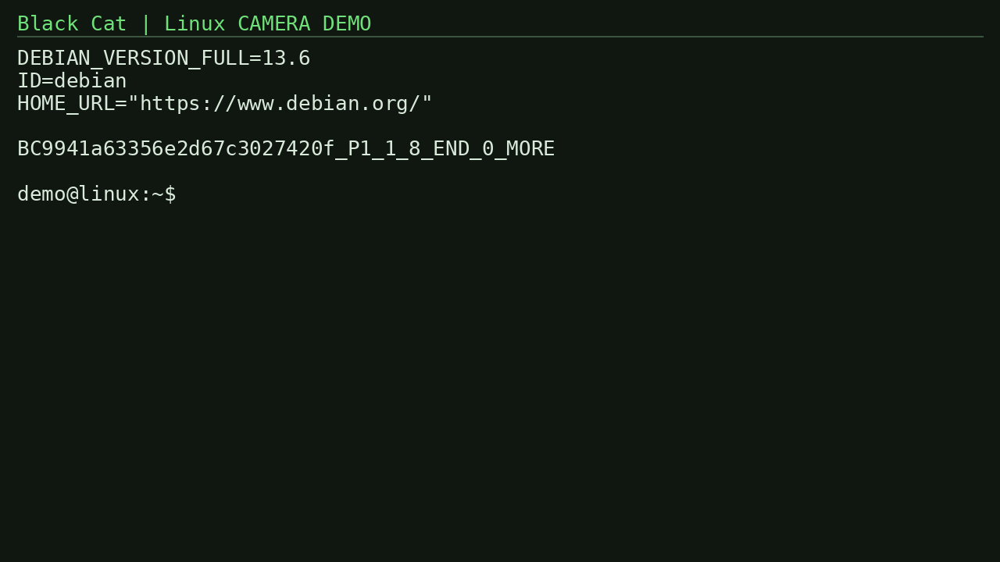

## command-010-terminal

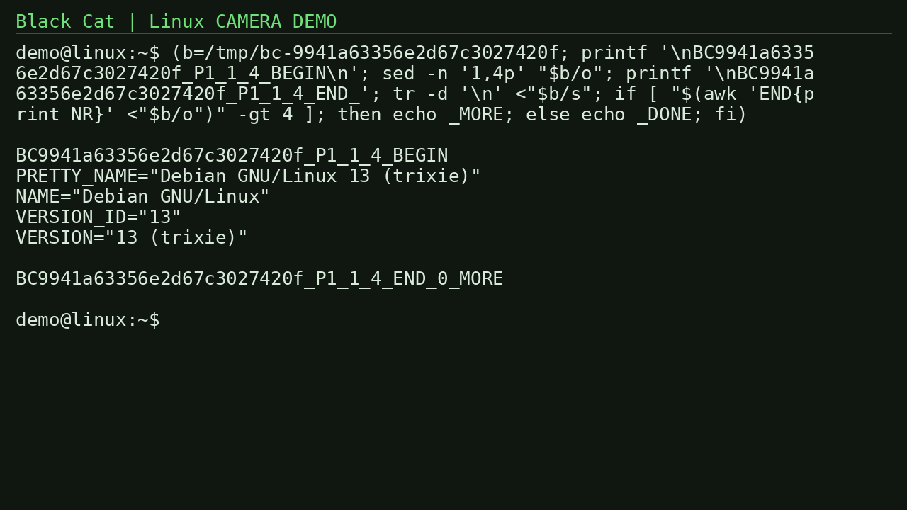

## command-011-terminal

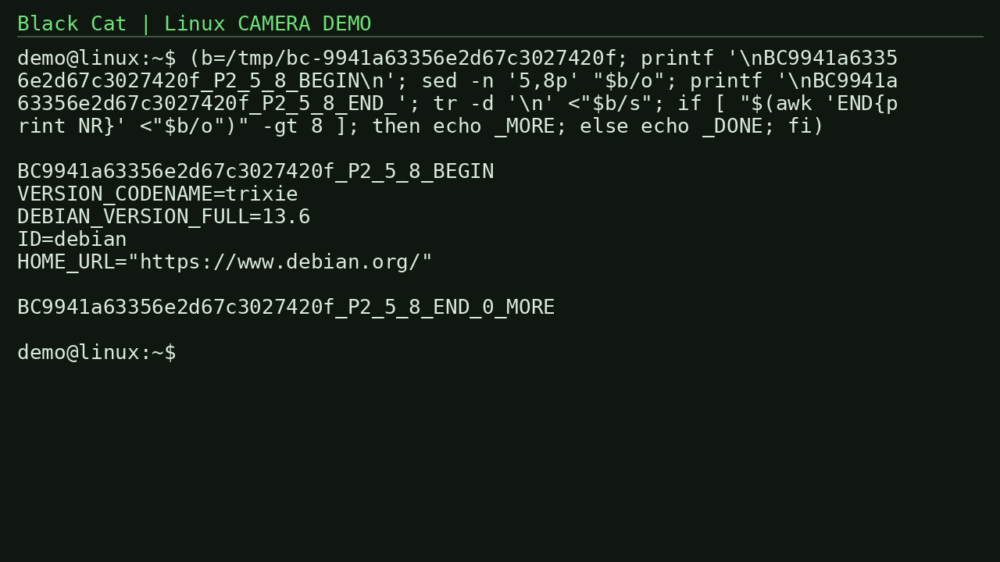

## command-012-terminal

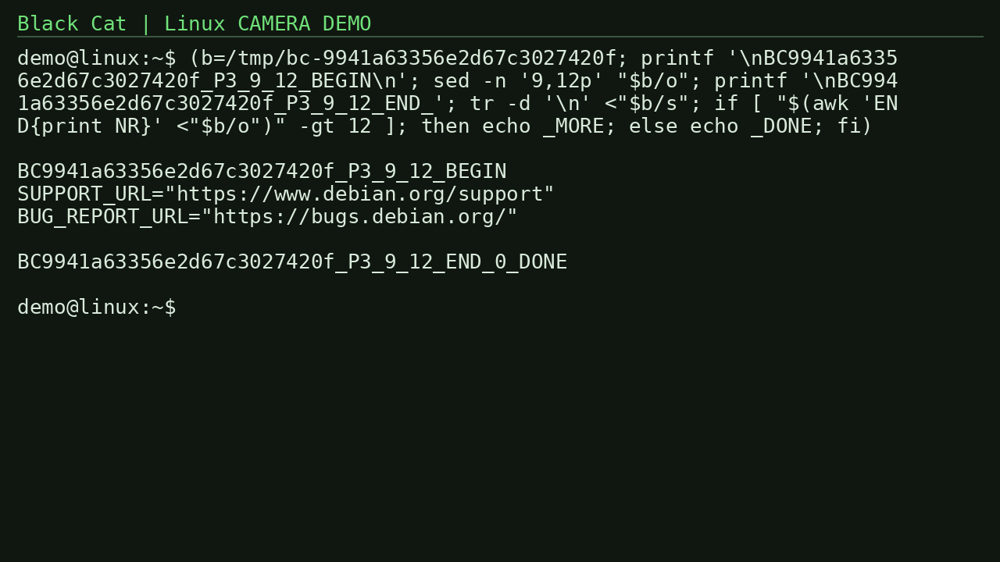

## command-013-terminal

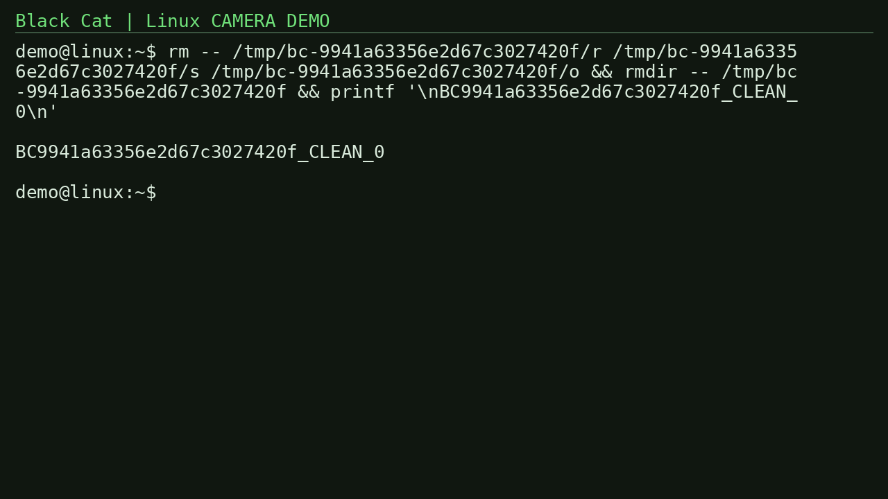

