# Native emulator screenshots

Earlier UI-identical candidate: source 5dc08a9, APK 9b3ef1a5c0cad9b5892f43328e649c2839539f6ddc6d49d6e414c1fd861f247f. The final production change affects only the observation decoder; these are not captures of the final APK. Actual PixelCopy captures. Synthetic providers/HID; physical testing remains.

## search-stream-01-topics

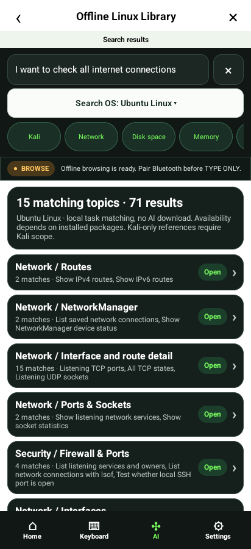

## search-stream-02-topic-commands

## search-stream-03-kali-scope

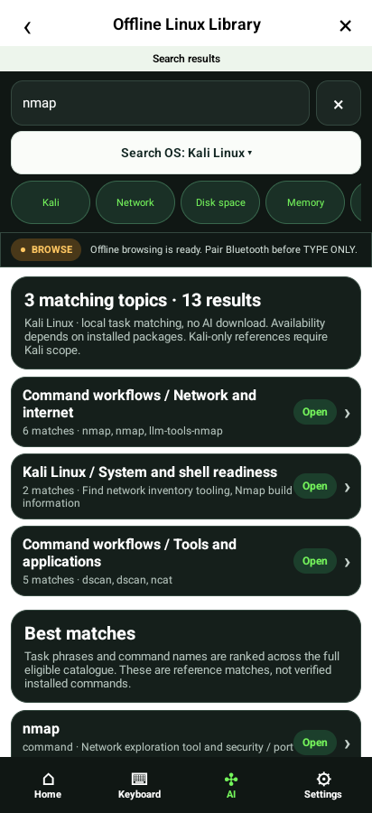

## search-stream-04-live-draft

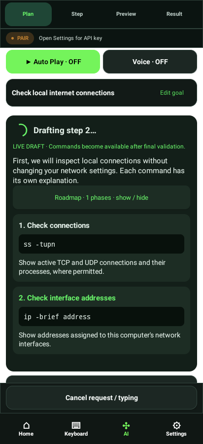

## search-stream-05-validated-plan

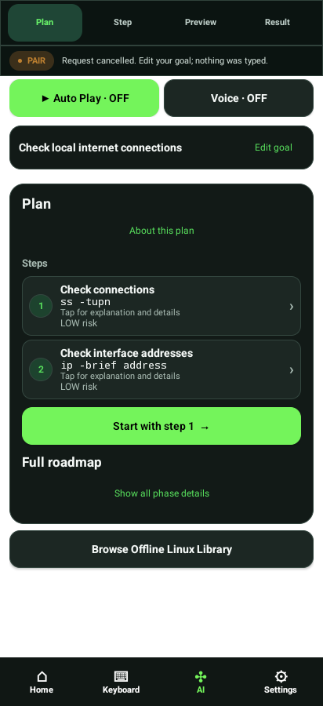

## search-stream-matrix-320-100

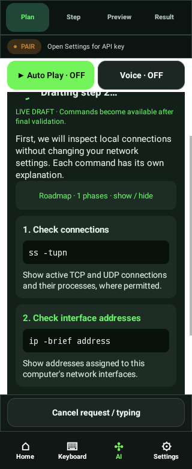

## search-stream-matrix-320-200

## search-stream-matrix-360-100

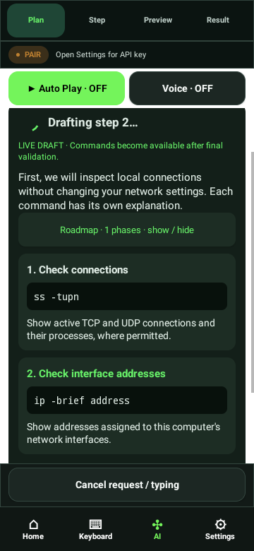

## search-stream-matrix-360-200

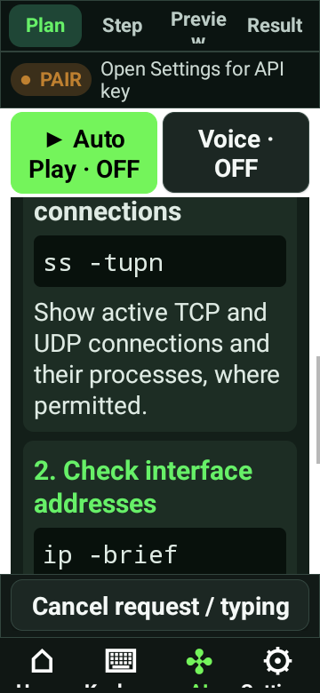

## search-stream-matrix-390-100

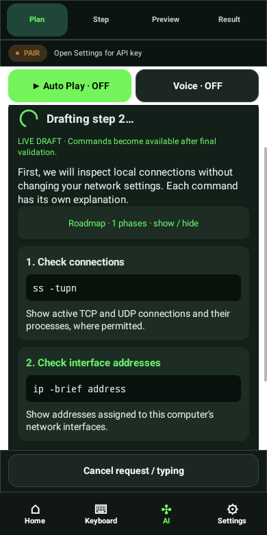

## search-stream-matrix-390-200

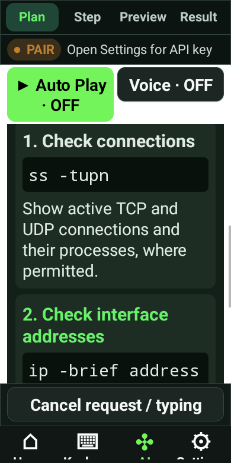

## search-stream-matrix-412-100

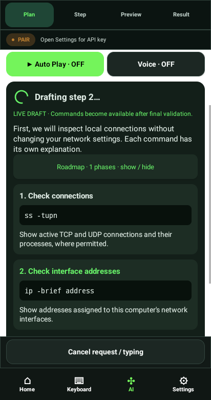

## search-stream-matrix-412-200

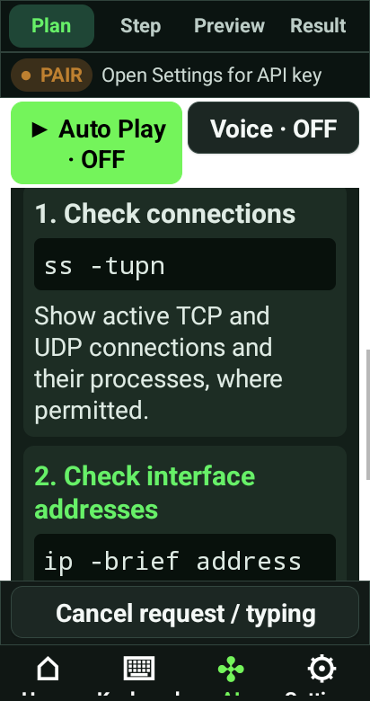

