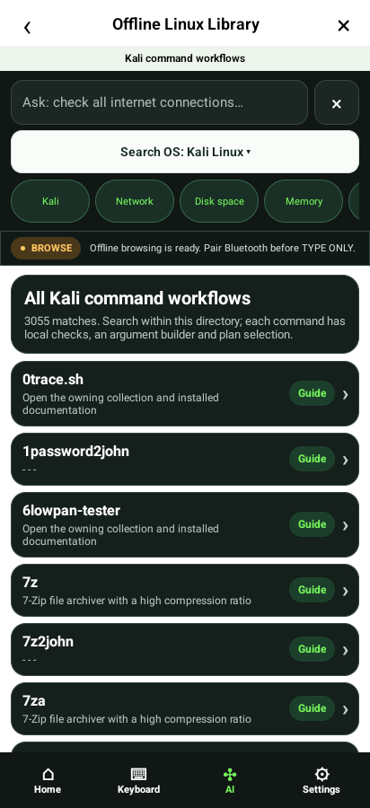
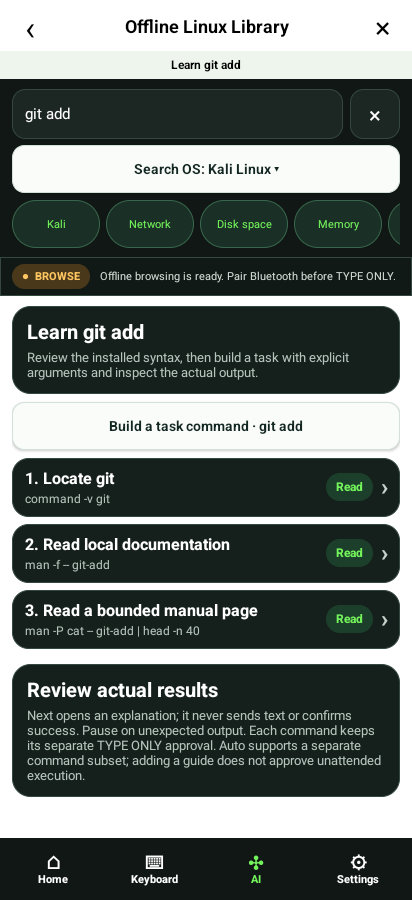
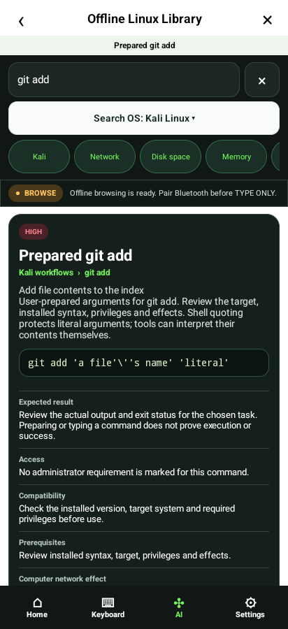
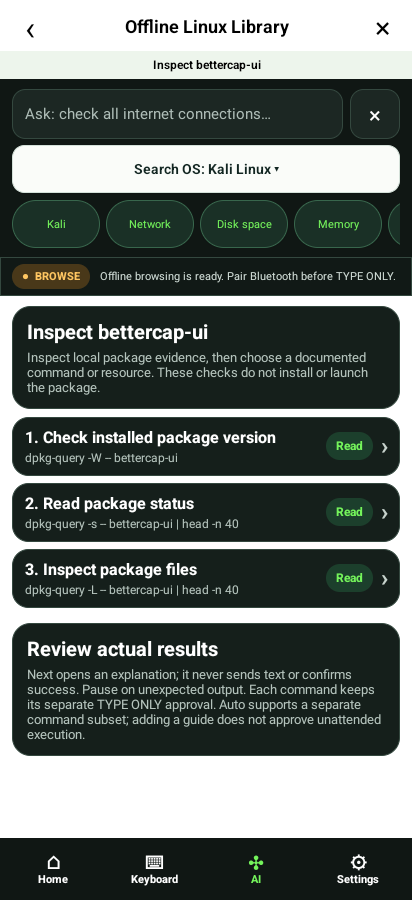
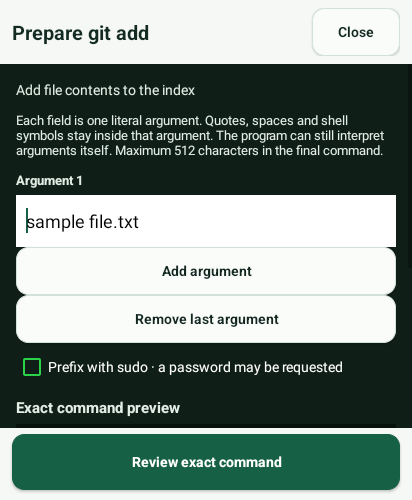
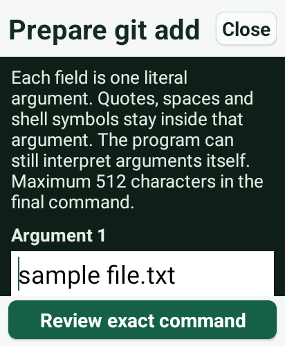

# Native emulator screenshots

Earlier UI-identical candidate: source 5dc08a9, APK 9b3ef1a5c0cad9b5892f43328e649c2839539f6ddc6d49d6e414c1fd861f247f. The final production change affects only the observation decoder; these are not captures of the final APK. Actual PixelCopy captures. Synthetic providers/HID; physical testing remains.

## workflows-01-kali-command-list

## workflows-02-subcommand-guide

## workflows-03-literal-argument-builder

## workflows-04-prepared-command

## workflows-05-package-only-guide

## workflows-06-guide-in-plan

## workflows-matrix-320-100

## workflows-matrix-320-200

## workflows-matrix-412-100

## workflows-matrix-412-200

