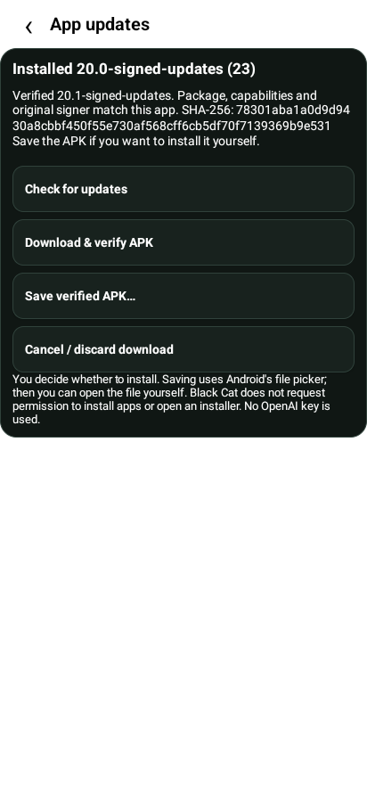
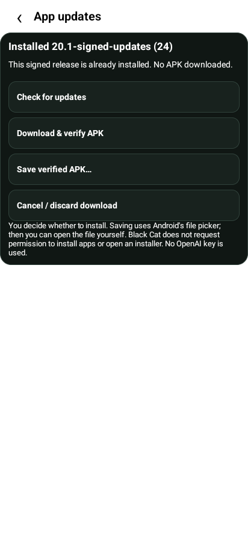

# CatAI-20.1 — signed update-check testing release

Latest full APK URL:

https://raw.githubusercontent.com/efrgdgr0024345/autophone/cb900fa3def981ee72c2c01a0fbb7cc8de6ab6ea/docs/ui20/install/CatAI-20.1.apk

Version `20.1-signed-updates`, build 24. Size 6,971,868 bytes; SHA256
`78301aba1a0d9d9430a8cbbf450f55e730af568cff6cb5df70f7139369b9e531`.
Install over the existing app to retain Settings and rollback history. Installation
is always a separate person-controlled action. No installation permission, installer
launch, APK signing configuration change or Bluetooth baseline promotion occurred.

Open **Settings → Check for updates → Check**. The real authority is provisioned
and the signed feed is live. Build24 reports already installed; later reviewed
versions can be downloaded, verified and explicitly saved through Android's picker.
Open the saved APK yourself using Files to choose whether to install it. An expired,
invalid, mismatched or unverifiable release fails closed.

An older installed CatAI-19/unprovisioned checker cannot learn a new trusted key
from an unauthenticated feed. Install this trust-enabled APK manually first.
The previously published bootstrap CatAI-20/build 23 is retained for reproducible
23→24 testing; build 24 changes the version and adds a genuine published-envelope
unit fixture, with the same updater implementation as build 23.

Bootstrap23 URL:
https://raw.githubusercontent.com/efrgdgr0024345/autophone/bad7b3c59872db983f99e25d703b5c39d7246eb6/docs/ui20/install/CatAI-20.apk

Offline CatBT-20.1/build 24 (no Internet/updater/camera/microphone):
https://raw.githubusercontent.com/efrgdgr0024345/autophone/cb900fa3def981ee72c2c01a0fbb7cc8de6ab6ea/docs/ui20/install/CatBT-20.1.apk

## Exact-source evidence

[Machine-readable evidence](EVIDENCE.json) records source and artifact identities:

- Final app source **844dda4db94b185a7bcefd6353a56b37ad346f82**.
- Bootstrap app source **65a358563ab4ffa298ee2847fb414b09ed801e85**.
- Final test driver **ef64b1ce155991b9c4b8a96ae36b0d0c723e17b1**. Subsequent
  driver fixes affect only the test picker/provider, never either published app.
- Rollback **b51ef53538aa95adfd884329eda9763b63bce413**; branch
  `feature/ui20-provisioned-release`. No merge or main/baseline promotion.
- Final source: 244 Android unit tests (217 AI/27 offline), zero failures/errors/skips;
  Lint zero errors, 98 AI/30 offline warnings. 122 Python tests and 40 planner contracts
  pass at the driver checkpoint. Actual publisher→Kotlin verifier interoperability
  is covered with a real signed public release-envelope fixture outside the APK.
- Both exact published APKs pass permission/package/nondebuggable/license checks,
  metadata-authority/test-provider leakage guards and existing signer continuity.
  [Signature output](checks/final-signature-ai.log), [APK checks](checks/final-apk-ai.log),
  [frozen boundaries](checks/final-update-policy.log).

## Android12 emulator tests

40 checks passed across the two exact published APKs:

- [Bootstrap23 real offered upgrade: 5](live-upgrade23/instrumentation.log).
  Real HTTPS seq2 metadata/pinned signature; genuine old seq1 rejected by persistent
  floor; actual hosted 24 APK cryptographic signer/hash/size/package/version/permission
  checks; explicit export through production ContentResolver; private session cleared.
- [Installed24 real current-version result: 3](live-current24/instrumentation.log).
  Same real signature/old-feed rejection; no download/export for already-installed 24.
- [Final24 updater: 5](final-native-updates/instrumentation.log),
  [Auto/key/evidence: 5](final-native-evidence/instrumentation.log), and
  [planner/camera/manual/Auto regressions: 22](final-native-all/instrumentation.log).

The API31 AOSP-ATD emulator uses software TCG and the cloud's HTTPS CONNECT proxy.
Its disposable system trust store additionally trusts the cloud's public test CA;
platform TLS and hostname verification in the app are unchanged. No permissive TLS
handler or test CA is shipped. Real hosted responses and signed bytes were checked.
No paid OpenAI requests or real user photographs/keys were used.

ATD lacks a normal interactive DocumentsUI picker. The instrumentation-only picker
interceptor returns an explicit fixed URI backed by a test-only, emulator/signature/
UID-restricted provider, with a shell-granted destination permission. Production
ContentResolver writes and reads back exact bytes. The fixture initially mismatched
the MIME filter and URI grant; the app correctly cancelled/discarded the download.
Those test-driver defects were corrected, then the complete test passed. No fixture
provider or canned metadata is packaged in either application APK.

The 22-check instrumentation suite passed before its shell wrapper failed during
artifact collection: the wrapper file had been edited while that shell was waiting
for instrumentation. Screenshots were pulled separately, and pass markers/installed
hashes were independently verified. No Android test assertion was skipped. The
final wrapper `9f83424cb62998abaa79f103a1c48497885962cf` is syntax-checked and its live
current-version scenario separately passes [two additional checks](runner-live-current24/instrumentation.log); this is a test-runner correction,
not an application change.

Installation was a separate owner-directed `adb install` of independently downloaded,
hash-checked public 24 bytes. This demonstrates emulator package/signature upgrade
continuity, not physical Files-picker/installer acceptance. Planner/observer/HID
regressions use synthetic providers; Camera2 JPEG, Keystore and rendering run on
Android. Physical Bluetooth, camera optics, audio and handset acceptance remain.

## Security status and maintenance

Real public metadata SPKI SHA256:
`8cb2f3d61ba630c526a2b3dd47449f540e1a2666414da6166655eba441147a1f`.
The independently retained APK signer is still the existing **Android Debug**
certificate `fc5c0b42b9da40c2507d8f2e77ed92db9e023740aa1a44d1a3b2c14a6e9f4764`.
Signer continuity is verified; no production APK signing-custody assurance is claimed.
Private metadata key and password are outside Git/APKs/GitHub. The owner must keep
the encrypted backup and password separately outside this temporary workspace.

[CodeQL output](checks/final-codeql.sarif) for exact final app source 844 covers all 69
then-checked-in Kotlin files (CLI 69/70 Java/Kotlin). **Five existing security findings
remain open**: missing certificate pinning in unchanged OpenAI clients, plus 30 quality
notes. [Explicit retained triage](checks/codeql-triage.json). No suppression or clean
security-gate claim. Later instrumentation-only fixes are runtime-tested, not falsely
represented as part of the earlier source 844 CodeQL trace.

The live seq2 feed expires **29 October 2026, 00:55:58 EDT**. GitHub denied the
integration Actions secrets access (HTTP403 over HTTPS). **Scheduled renewal is not
configured.** [Manual renewal and private backup custody](../updates/PUBLISHING.md)
are required before expiry; an expired feed is rejected. The app's installed
functions keep working. OpenAI credentials are not required for updates; phone AI
requests still use the user's phone-saved key. App-local rollback floors can reset
on uninstall/data clearing or privileged filesystem rollback; installed version
remains a separate floor. No key rotation or emergency recovery channel is implied.

[OCR evaluation](../updates/OCR-EVALUATION.md) remains observation-only documentation.
No ML Kit dependency, Camera2 change, stable-evidence delay replacement or nonce/page/
completeness relaxation was implemented. Frozen Bluetooth/manual/planner/Auto/vault
and offline-flavor boundaries remain unchanged.
