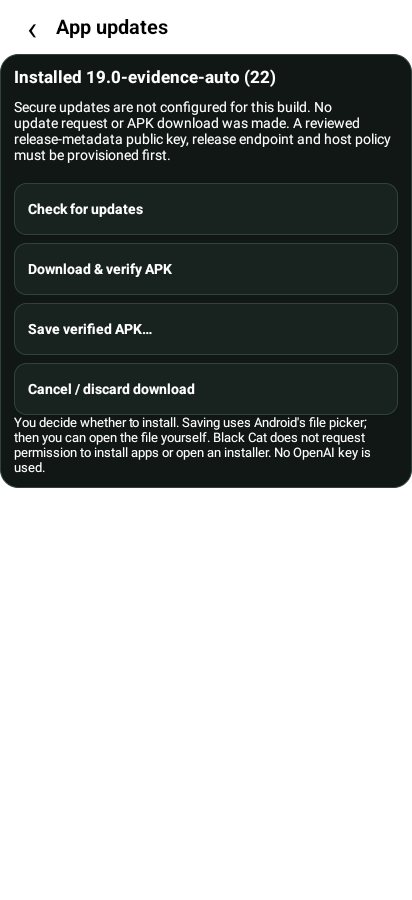

# Signed update checks — review delivery

Exact tested application/test source:
`64d3caae9d807bcd07c0caf5e8b0d23c576d3fee`.
Branch: `feature/ui20-authenticated-updates`.
Rollback: `bd7f38295404721c984ede7813a363a46ae02aba` (approved CatAI-19 lineage).
Later documentation/evidence commits do not rebuild or change those tested sources.

Settings now has **Check for updates**. The implemented path authenticates signed
metadata, enforces expiry and persistent rollback floors, restricts HTTPS redirects,
and validates the APK's exact hash/size/package/version/current signing certificate
and permission set. A verified APK can be saved through Android's file picker;
installation is a separate user action. No installation permission, production-key
creation, signing change or new APK publication occurred.

**Production trust is unprovisioned.** Check reports that state and makes no update
request. Reviewed metadata public key/key ID, release endpoint, host policies,
channel and a real signed publishing process are required before a trust-enabled
bootstrap build and live service/save/install tests. Test-only keys are absent
from production trust. This is not an operational update channel.

## Evidence

- [Machine-readable record](EVIDENCE.json), [security design and provisioning contract](SECURITY-DESIGN.md).
- 243 Android unit tests (216 AI, 27 offline), including 30 new updater tests;
  105 Python checks and 40 planner contracts: all pass.
- Both APK builds, exact flavor permission/identity checks and preservation guards:
  pass. Lint: zero errors; 98 AI/30 offline warnings (16 added English-translation notes).
- 32 Android12 emulator checks on the exact final AI APK: [updater](emulator-updates/instrumentation.log),
  [Auto/key/evidence](emulator-evidence/instrumentation.log),
  [planner/camera/manual review/Auto](emulator-all/instrumentation.log).
  Real Camera2 JPEG, Android Keystore and app-window rendering; synthetic planner,
  observer and HID target. These are not physical Bluetooth or live release-service tests.
- CodeQL covers all 67 checked-in Kotlin files and completed with **five open security
  findings**, all certificate-pinning warnings in unchanged OpenAI clients, plus 30
  quality notes. [Raw SARIF](checks/codeql.sarif), [explicit triage](checks/codeql-triage.json).
  Findings are retained without suppression. No clean security-gate claim is made.
- Both retained CatAI-19/CatBT-19 APKs and new test APKs verify with the original
  certificate digest. It remains the existing **Android Debug** identity; continuity
  is not production key-custody assurance. Only public certificate data is recorded.

The private, unpublished AI test APK is 6,970,288 bytes, SHA-256
`76a2249d942c2c0404b9c172d0042c00b7cf0a44bca8e9be7756ff8cb952705f`.
The offline test APK is 6,097,885 bytes, SHA-256
`181c56e5af187c1f08a5b7fd5102ac90a846e0702d1bf5446a6bb4765bf10140`.
All three emulator suites recorded the installed AI APK's matching hash.
Version stays `19.0-evidence-auto`/22; the UI19 public download is unchanged.

## OCR evaluation only

[Bundled ML Kit / Camera2 proposal](OCR-EVALUATION.md): fresh local evidence with
capture generations/timestamps, bounded asynchronous recognition, exact nonce/
page/exit/completeness validation, and an observation-only stability experiment.
Stable text alone cannot establish completion or keyboard focus. Camera2, the
fixed five-second wait and all existing Auto validators are unchanged. No ML Kit
dependency or OCR implementation was added. No accuracy/latency claims are made.

## Remaining review

Provision update trust and publishing ownership; review the existing pinning
findings and production-signing custody separately; then run real authenticated
release-service/download/file-picker/physical update-install acceptance. Clearing
app data or privileged filesystem rollback can reset app-local rollback history;
the installed version is an independent floor. The OCR prototype needs separate
approval before implementation or any timing/automation change.
